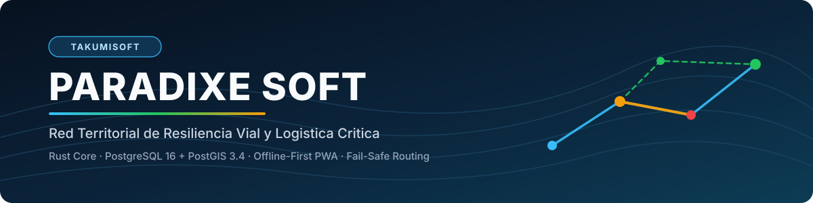
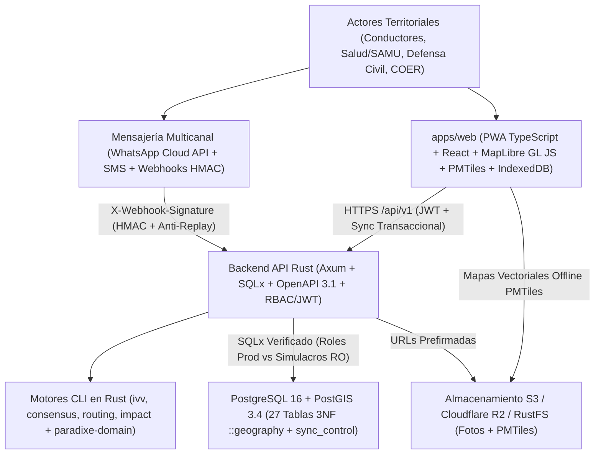

<div align="center">



<p>
  <strong>Red Territorial Offline-First de Resiliencia Vial, Predicción Geotécnica y Logística Crítica</strong><br/>
  Desarrollado por <strong>TakumiSoft (TAKUMISOFT)</strong> · Corredor piloto <em>Huánuco – Ambo – Carpish – Tingo María</em>
</p>

<p>
  <a href="https://github.com/jhoaodidier/PARADIXE-SOFT/actions/workflows/ci.yml"></a>
  
  
  
  
  
</p>

<p>
  <a href="./docs/PARADIXE_SOFT.md">Especificación SDD</a> ·
  <a href="./openapi/openapi-v1.json">Contrato OpenAPI 3.1</a> ·
  <a href="#inicio-rapido">Inicio Rápido</a> ·
  <a href="#motores-cli-en-rust">Motores Rust CLI</a> ·
  <a href="./SECURITY.md">Seguridad</a> ·
  <a href="./CONTRIBUTING.md">Contribuir</a>
</p>

</div>

---

## Visión del Producto

En corredores andino-amazónicos como **Huánuco – Carpish – Tingo María**, un único deslizamiento o huaico durante la temporada de lluvias puede aislar provincias enteras, retrasar referencias médicas hacia el **Hospital Regional Hermilio Valdizán** y deteriorar toneladas de carga agrícola perecible (papa, café, cacao, frutas).

**PARADIXE SOFT** optimiza la red de transporte multimodal existente —**ambulancias $4\times 4$, camionetas, camiones agrícolas, carga pesada y motocicletas**— combinando datos abiertos (`OSM`, `DEM SRTM/ALOS`, `MTC/INGEMMET`, `SENAMHI`, `NASA GPM`, `Open-Meteo`), operación **Offline-First** en móviles rurales y un núcleo determinista en **Rust** para garantizar ultra bajo consumo energético y latencia predecible.

> [!IMPORTANT]
> **Principio Operativo *Fail-Safe* (Apoyo a Decisión):**  
> PARADIXE SOFT no sustituye a **COER**, **Defensa Civil** ni personal médico, ni emite órdenes vinculantes de tránsito. Cuando faltan datos climáticos vigentes (`STALE_IVV`), no existen atributos físicos validados en campo (`UNVERIFIED_PHYSICAL_ATTRIBUTES`) o el riesgo impide una ruta verificable, el sistema responde explícitamente **`NO_SAFE_ROUTE`** con causa diagnóstica única en lugar de improvisar rutas peligrosas.

---

## Arquitectura de Producción (Opción A)



### Capacidades por Capa

| Capa / Módulo | Responsabilidad Clave | Garantía Técnica |
| :--- | :--- | :--- |
| **Capa 1 — Predicción Geotécnica ($IVV$)** | Calcula cada 3 horas el Índice Dinámico de Vulnerabilidad Vial (`GREEN`, `AMBER`, `RED`) cruzando precipitación 24–72 h, pendiente máxima, distancia a quebrada, suelo y puntos críticos. | Precisión `rust_decimal` con redondeo `MidpointAwayFromZero` idéntico a `NUMERIC` de PostgreSQL; si vence (`> 3 h`) pasa a `UNKNOWN` / `is_stale`. |
| **Capa 2 — Detección Híbrida y Privacidad** | Separa el estado de verificación (`SUSPECTED`, `CONFIRMED`, `DISMISSED`, `RESOLVED`) de la transitabilidad (`OPEN`, `CAUTION_SUSPECTED`, `PARTIAL_ONE_LANE`, `BLOCKED`). | Telemetría GPS con `client_ephemeral_id` rotado diariamente + `HMAC-SHA256` (clave fuera de BD, purga `24 h`); consenso comunitario acotado por proximidad `::geography <= 500 m`. |
| **Capa 3 — Enrutamiento y Puente Logístico** | Grafo dirigido bidireccional (`ST_Reverse`, pendientes ida/vuelta), poda conservadora por vehículo, ventanas humanitarias direccionales y propuesta de corredores de transbordo. | Todo puente nace `PROPOSED`; exige inspección vigente, ausencia de peligro (`NOT ST_DWithin`), idoneidad por carga y aprobación humana explícita. |
| **Módulo de Simulacros COER** | Evaluación aislada de escenarios estacionales (`WEATHER_OVERRIDE`, `BLOCKAGE_OVERRIDE`) con cálculo de tiempo, $\text{CO}_2$ y merma agrícola. | Principal PostgreSQL de solo lectura sobre tablas operativas; `NO_SAFE_ROUTE` fija deltas en `null` y preserva deltas negativos de $\text{CO}_2$ sin truncar signos. |

---

## Motores CLI en Rust

Siguiendo los **Artículos I y II SDD (*Library-First & CLI*)**, cada motor del núcleo es una librería independiente sin `#![allow(unsafe_code)]` (`#![forbid(unsafe_code)]`) acompañada de un binario CLI JSON determinista (`stdin`/`stdout`):

| Crate | Propósito | Cobertura Clave |
| :--- | :--- | :--- |
| [`paradixe-domain`](./crates/paradixe-domain) | Tipos algebraicos, enums *Fail-Safe*, precedencia de los 11 `reason_code` y redondeo `MidpointAwayFromZero`. | `RoutingResolution`, `SimEventRequest`, `NoSafeRouteReasonCode` |
| [`paradixe-ivv`](./crates/paradixe-ivv) | Cálculo determinista del índice $IVV$ y control de caducidad (`IVV-01`, `IVV-02`). | `100.00`, `3.00`, tramo Carpish `84.00 RED`, expiración `3 h` |
| [`paradixe-consensus`](./crates/paradixe-consensus) | Hash seudónimo HMAC diario, clúster GPS (`SUSPECTED` únicamente) y consenso comunitario (`CON-01`). | Deduplicación `30 min`, apoyo $S \ge 1.00$, margen $\ge 0.50$ |
| [`paradixe-routing`](./crates/paradixe-routing) | Enrutador bidireccional Dijkstra, ventanas humanitarias y Puente Logístico (`RTE-01..04`, `BRG-01..03`). | Poda vehicular, ventanas `[entry, exit]`, precedencia diagnóstica |
| [`paradixe-impact`](./crates/paradixe-impact) | Evaluador reproducible de tiempo, $\text{CO}_2$ y merma agrícola (`SIM-01`, `SIM-02`, `IMP-01`). | `null` en `NO_SAFE_ROUTE`, deltas negativos preservados |
| [`paradixe-api`](./crates/paradixe-api) | API Core Axum + SQLx (endpoints `/api/v1`, JWT/Argon2id/OTP, `sync_control`, certificación auditada, simulacros RO). | `SEC-01..07`, `GEO-01..03`, `SYN-01..04`, `E2E-01` sobre PostGIS |
| [`paradixe-ingestor`](./crates/paradixe-ingestor) | Ingestor multi-región (`#![forbid(unsafe_code)]`): OSM PBF Geofabrik, NASA SRTM 30m, Open-Meteo IVV cada 2 h y `PMTiles v3` en RustFS/S3. | `PE-HUC` (11 provincias y distritos), `PE-PAS`, `PE-JUN`, `PE-UCA`, `PE-SAM`, `PE-ANC`, `PE-ALL`, `--bbox` |
| [`paradixe-messaging`](./crates/paradixe-messaging) | Pasarela multicanal Etapa 3 (`#![forbid(unsafe_code)]`): WhatsApp Cloud API + fallback SMS + parser ciudadano + puente HMAC hacia `paradixe-api`. | Webhooks `GET/POST /webhooks/whatsapp`, `POST /webhooks/sms`, parser ES-PE |

### Ejemplo Ejecutable (`paradixe-ivv` CLI)

```bash
cargo run -q -p paradixe-ivv << 'JSON'
{
  "model": {
    "version_tag": "ivv-v1.0-initial",
    "w_precip": 0.350,
    "w_slope_ravine": 0.300,
    "w_soil": 0.200,
    "w_hotspot": 0.150,
    "precip_24h_cap_mm": 80,
    "precip_72h_cap_mm": 180,
    "slope_cap_pct": 45,
    "ravine_max_dist_m": 500,
    "amber_threshold": 40,
    "red_threshold": 70,
    "validity_hours": 3
  },
  "segment": {
    "max_slope_forward_pct": 27.0,
    "soil_susceptibility_idx": 0.80,
    "distance_to_ravine_m": 200,
    "is_historical_hotspot": true
  },
  "observation": {
    "precip_24h_mm": 85.0,
    "precip_72h_mm": 190.0,
    "observed_at": "2026-11-21T08:00:00Z"
  }
}
JSON
```

Salida determinista esperada: `"ivv_score": "84.00"`, `"risk_level": "RED"`.

---

## Estructura del Repositorio

| Ruta | Descripción |
| :--- | :--- |
| [`crates/`](./crates) | Cargo Workspace en Rust (`paradixe-domain`, `paradixe-ivv`, `paradixe-consensus`, `paradixe-routing`, `paradixe-impact`, `paradixe-api`, `paradixe-ingestor`, `paradixe-messaging`) |
| [`apps/web/`](./apps/web) | PWA Offline-First en React + TypeScript + MapLibre GL JS + PMTiles + IndexedDB + SSE |
| [`openapi/openapi-v1.json`](./openapi/openapi-v1.json) | Contrato OpenAPI 3.1.0 canónico (`/api/v1`, 40 rutas y esquemas discriminados) |
| [`migrations/`](./migrations) | Esquema PostgreSQL 16 + PostGIS 3.4 (`0001`..`0005`: 3NF, `territorial_units`, pronósticos IVV +72h y suscripciones de flota) |
| [`infra/`](./infra) | Nginx reverse proxy HTTP/2 + SSE y configuración de despliegue productivo |
| [`docker-compose.yml`](./docker-compose.yml) | Orquestación local de PostGIS 16 y RustFS S3 en Rust (puerto 9000 / consola 9001) |
| [`docker-compose.prod.yml`](./docker-compose.prod.yml) | Stack productivo completo (`postgres`, `rustfs`, `api`, `messaging`, `weather-worker`, `web`) |
| [`scripts/`](./scripts) | Bootstrap DB, semillas, daemon meteorológico y validación integral (`verify_full_e2e.sh`) |
| [`.github/workflows/ci.yml`](./.github/workflows/ci.yml) | Pipeline CI en GitHub Actions (Rust fmt/clippy/test, PWA Vite/Vitest y migraciones PostGIS) |
| [`docs/PARADIXE_SOFT.md`](./docs/PARADIXE_SOFT.md) | Especificación técnica ejecutable completa (`2.0.0-prod-sdd-rust`) |
| [`.github/PULL_REQUEST_TEMPLATE.md`](./.github/PULL_REQUEST_TEMPLATE.md) | Checklist SDD, PostGIS `::geography`, privacidad y pruebas para Pull Requests |
| [`.agents/skills/modern-web-guidance/SKILL.md`](./.agents/skills/modern-web-guidance/SKILL.md) | Skill de estándares web modernos vinculada al desarrollo frontend |

---

## Inicio Rápido

### 1. Requisitos del Sistema
* **Rust** (`rustup` / `rustc` / `cargo` stable con `rustfmt` y `clippy`)
* **Node.js** ($\ge 22$) y **npm**
* **Docker** y **Docker Compose** (opcional en local para PostgreSQL + PostGIS y RustFS)

En Arch / CachyOS Linux:
```bash
sudo pacman -S --needed docker docker-compose postgresql-libs postgresql nodejs npm
sudo systemctl enable --now docker
sudo usermod -aG docker "$USER"
curl --proto '=https' --tlsv1.2 -sSf https://sh.rustup.rs | sh -s -- -y --component rustfmt,clippy
```

### 2. Verificación del Núcleo Rust
```bash
cargo fmt --all -- --check
cargo clippy --workspace --all-targets -- -D warnings
cargo test --workspace
```

### 3. Verificación de la PWA Offline-First
```bash
cd apps/web
npm install
npm run gen:api
npm run typecheck && npm test && npm run build
```

### 4. Base de Datos Espacial, Migraciones y Pruebas de Integración PostGIS
```bash
cp .env.example .env
docker compose up -d
./scripts/bootstrap_dev_db.sh
cargo test -p paradixe-api --test integration_postgis -- --ignored --test-threads=1
```

### 5. Ingesta Territorial Multi-Región (OSM, NASA SRTM 30m, Open-Meteo IVV y PMTiles v3)
```bash
# Ingesta completa de Huánuco (`PE-HUC`), Pasco (`PE-PAS`), Junín (`PE-JUN`) y Ucayali (`PE-UCA`)
# Cobertura Macro-Región Centro: 27 provincias, 424 distritos y PMTiles v3 en RustFS
cargo run --release -p paradixe-ingestor -- sync-all --region PE-HUC --download
cargo run --release -p paradixe-ingestor -- sync-all --region PE-PAS --download
cargo run --release -p paradixe-ingestor -- sync-all --region PE-JUN --download
cargo run --release -p paradixe-ingestor -- sync-all --region PE-UCA --download

# Sincronización de puntos críticos geotécnicos y pronóstico determinista +24h/+48h/+72h
cargo run --release -p paradixe-ingestor -- hotspots-sync
cargo run --release -p paradixe-ingestor -- forecast-sync

# Refresco periódico de lluvia 24h/72h e IVV determinista cada 2 horas
./scripts/run_weather_daemon.sh PE-HUC 2
```

### 6. Consola Web en Vivo, Tiempo Real (SSE), Evidencias S3 y Pasarela WhatsApp/SMS
```bash
# 1. Crear usuarios operadores locales (COER_ADMIN, CIVIL_DEFENSE, HEALTH_OPERATOR)
cargo run -p paradixe-api --bin seed_dev_users

# 2. Levantar API Core en http://127.0.0.1:8080 (incluye SSE /api/v1/events/stream, S3 y /metrics)
cargo run -p paradixe-api --bin paradixe-api

# 3. Levantar pasarela WhatsApp Cloud API + SMS en http://127.0.0.1:8090
cargo run -p paradixe-messaging -- serve

# 4. Levantar PWA con proxy hacia /api, /tiles y /evidence (http://localhost:5173)
cd apps/web && npm install && npm run dev

# 5. Verificación End-to-End completa sobre PostGIS, RustFS, API y Mensajería
./scripts/verify_full_e2e.sh
```

### 7. Despliegue Productivo con Docker Compose
```bash
# Stack completo: PostGIS 16 + RustFS S3 + paradixe-api + paradixe-messaging + weather-worker + Nginx PWA
docker compose -f docker-compose.prod.yml config -q
docker compose -f docker-compose.prod.yml up -d --build
```
Incluye streaming en tiempo real vía Server-Sent Events (`/api/v1/events/stream`), evidencias fotográficas presignadas/proxy en RustFS (`/api/v1/uploads/{presign,evidence}`), suscripciones de alertas para flotas WhatsApp/SMS (`/api/v1/subscriptions`), exportación analítica COER y métricas Prometheus (`/metrics`).

---

## Hoja de Ruta de Producción

- [x] **Etapa 0 — Arquitectura SDD y Base de Datos:** Especificación `2.0.0-prod-sdd-rust`, esquema PostgreSQL 16 + PostGIS 3.4 (27 tablas 3NF + migraciones `0003`..`0005`), semillas base e infraestructura Docker (PostGIS + RustFS).
- [x] **Etapa 1A — Contrato OpenAPI 3.1 y Motores CLI en Rust:** `openapi-v1.json` (40 rutas), Cargo Workspace con `#![forbid(unsafe_code)]`, precisión `MidpointAwayFromZero` y suite de pruebas unitarias SDD.
- [x] **Etapa 1B — PWA Offline-First (`apps/web`):** MapLibre GL JS + PMTiles v3, paquetes regionales descargables en IndexedDB (`sync_control` + `outbox_queue`), captura fotográfica comprimida, GPS/WhatsApp UX y modo Sala COER / impresión.
- [x] **Etapa 2A — API Core (`paradixe-api`):** Servidor Axum/SQLx (`/api/v1`), podado espacial de ruteo, impacto económico, roles RBAC, registro de conductores, pasos de transbordo, SSE en vivo, S3 RustFS y métricas Prometheus (`/metrics`).
- [x] **Etapa 2B — Ingestor Real Multi-Región (`paradixe-ingestor`):** Worker escalable OSM Geofabrik + NASA SRTM 30m + puntos críticos geotécnicos (`hotspots-sync`) + pronóstico IVV `+24/+48/+72h` (`forecast-sync`) + `PMTiles v3` sobre la Macro-Región Centro (`PE-HUC`, `PE-PAS`, `PE-JUN`, `PE-UCA`).
- [x] **Etapa 3 — Mensajería Multicanal (`paradixe-messaging`):** Adaptadores de producción WhatsApp Cloud API y fallback SMS con parser ciudadano en español, despacho automático por suscripciones y firmas HMAC constantes.
- [x] **Etapa 4 — Plataforma Productiva B2B/B2G Lista para Piloto Macro-Regional:** Cobertura validada en 4 departamentos (27 provincias, 424 distritos), suite E2E viva (`verify_full_e2e.sh`) y despliegue productivo Docker Compose + Nginx.

---

<div align="center">
  <strong>TakumiSoft (TAKUMISOFT)</strong> · Ingeniería de resiliencia territorial sostenible
</div>
