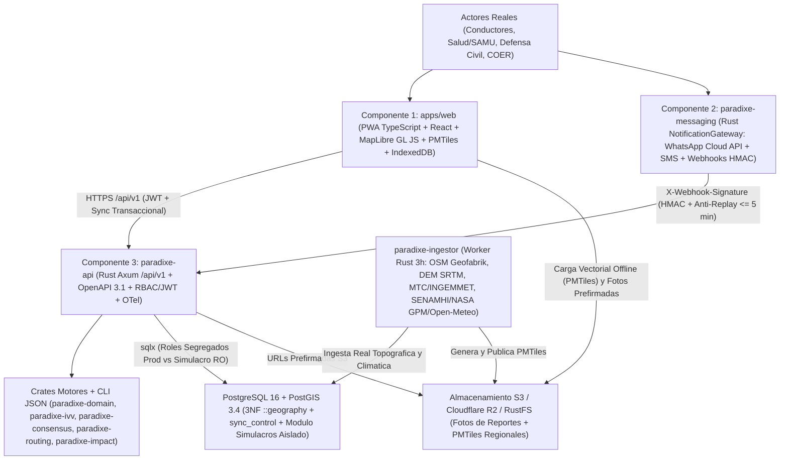

# PARADIXE SOFT — Especificación Técnica y Arquitectura de Producción

**Desarrollado por:** **TakumiSoft (TAKUMISOFT)**  
**Versión de Especificación:** `2.0.0-prod-sdd-rust` *(Arquitectura de Producción **Opción A**: Backend Core 100 % Rust + PWA Offline-First en TypeScript/MapLibre + PostgreSQL/PostGIS)*  
**Metodología de Ingeniería:** **Specification-Driven Development (SDD)** — *La especificación es la fuente de verdad ejecutable y verificable*.  
**Alcance Territorial Inicial:** Corredor Vial Central y Sierra-Selva (**Huánuco – Ambo – Carpish – Tingo María / Chavinillo, Puente Durand y rutas alternas/vecinales**), escalable a cualquier corredor andino-amazónico o rural de montaña.

---

## 1. Visión de Producto, Modelo B2B+B2G y Límites *Fail-Safe*

### 1.1 Propósito Operativo y Realismo Territorial

En regiones andino-amazónicas como **Huánuco y la Carretera Central**, el transporte terrestre es la única arteria económica y sanitaria. Cada temporada de lluvias (**noviembre a abril**) desencadena huaicos, deslizamientos de taludes y crecidas de ríos (**Huallaga, Higueras, Marañón**) que provocan:

* **Aislamiento súbito** de provincias enteras durante horas o días.
* **Ceguera operativa** de transportistas, ambulancias SAMU/postas rurales y productores agrícolas (papa, café, cacao, frutas), quienes descubren el bloqueo cuando ya quedaron atrapados en la fila o pierden cargas perecibles y retrasan referencias médicas hacia el **Hospital Regional Hermilio Valdizán** o Lima.
* **Colapso de rutas alternas** (por Canta, Oyón, Chavinillo o vías vecinales hacia Dos de Mayo/Lauricocha) cuando vehículos pesados ingresan a trochas sin control de pendiente, ancho de calzada ni capacidad portante.

**PARADIXE SOFT**, desarrollado por **TakumiSoft**, resuelve este problema sin requerir hardware propietario costoso a lo largo de cientos de kilómetros de carretera:

1. **Optimización sobre el Transporte Multimodal Existente:** Ambulancias rurales (`AMBULANCE_4X4`), camionetas (`PICKUP_4X4`), camiones agrícolas ligeros (`LIGHT_TRUCK`), carga pesada (`HEAVY_TRAILER`) y motocicletas de última milla (`MOTORCYCLE`).
2. **Arquitectura *Offline-First* de Bajo Ancho de Banda:** Caché vectorial geográfica en **PMTiles** + **IndexedDB** + `outbox_queue` persistente con sincronización diferencial transaccional cuando retorna la señal celular, complementada con alertas y captura vía **WhatsApp Cloud API (Meta)** y **SMS fallback**.
3. **Pipeline de Datos Reales (`paradixe-ingestor`):** Red vial desde **OpenStreetMap (Geofabrik Perú)** y capas oficiales **MTC / Provías Nacional y Descentralizado**, pendientes reales calculadas con modelos digitales de elevación (**DEM: SRTM / ALOS PALSAR**), inventario de puntos críticos **INGEMMET / Provías** e ingesta meteorológica automatizada cada 3 horas (**SENAMHI**, **NASA GPM IMERG**, **Open-Meteo** y estaciones locales calibradas `LOCAL_STATION`).
4. **Puente Logístico Verificado y Corredor Humanitario:** Cuando no existe desvío vehicular seguro, evalúa corredores de transbordo inspeccionados y vigentes a ambos lados del corte, sujetos siempre a aprobación humana autorizada.

### 1.2 Estrategia de Viabilidad Comercial y Legal (Dual B2B + B2G)

* **Tracción B2B inmediata (Transporte y Agroindustria):** Operadores logísticos, empresas de transporte interprovincial y cooperativas agrícolas adoptan alertas tempranas, reporte comunitario y ruteo sensible al vehículo para evitar mermas de carga perecible y tiempos muertos.
* **Alianza institucional B2G (COER, Defensa Civil y Redes de Salud/SAMU):** El panel de verificación oficial (`COER_ADMIN`, `CIVIL_DEFENSE`), la gestión de ventanas humanitarias y el módulo aislado de **Simulacros y Contingencia (*What-If / Drills*)** habilitan la validación institucional que distingue a **PARADIXE SOFT** frente a navegadores comerciales genéricos.
* **Gobernanza y Criterio Irrenunciable *Fail-Safe*:**
  * **PARADIXE SOFT** es una plataforma de **apoyo a la decisión**, no un sistema autónomo de despacho de emergencias.
  * No envía órdenes vinculantes de tránsito, no declara un sendero seguro por inferencia algorítmica y **nunca suplanta a COER, Defensa Civil ni personal médico**.
  * Toda ruta devuelta incluye procedencia, marca temporal, nivel de incertidumbre y `operational_authorization = REQUIRED`. La plataforma jamás decide por sí sola el traslado de un paciente.
  * Los atributos viales no validados en campo (`attributes_verified_at IS NULL`) **no pueden autorizar despacho real** (`UNVERIFIED_PHYSICAL_ATTRIBUTES`).

---

## 2. Arquitectura de Producción — Opción A (Rust Core + PWA TypeScript + PostGIS)

### 2.1 Por qué Opción A es la Arquitectura más Profesional, Sostenible y Viable

**TakumiSoft** adopta la **Opción A**: todo el cómputo crítico, motores geoespaciales, seguridad, ingesta y API transaccional se construyen en **Rust**, mientras la experiencia móvil y de mapa *Offline-First* se construye como **PWA en TypeScript (`React + Vite + MapLibre GL JS + PMTiles`)** con tipos y cliente autogenerados desde el contrato **OpenAPI 3.1** emitido por Rust:

1. **Sostenibilidad Energética y Costo Operativo Mínimo (Rust):** Sin *Garbage Collector*, latencia predecible `< 2 s` en grafos regionales y huella mínima de CPU/RAM. Un nodo completo + PostGIS + RustFS/R2 opera con un costo mensual inicial aproximado de **$20–$40 USD/mes**, o en servidores modestos locales de un Gobierno Regional / COER.
2. **Seguridad y Determinismo en Compilación:**
   * Tipos algebraicos (`enum`) discriminados para `VerificationState`, `PassabilityState`, `RoutingResolution`, los 11 `NoSafeRouteReasonCode` y eventos de simulacro `SimEventPayload`, eliminando estados ilegales en compilación.
   * Precisión decimal exacta mediante `rust_decimal::Decimal` con estrategia **`MidpointAwayFromZero`**, garantizando coincidencia al centésimo con `NUMERIC` de PostgreSQL.
   * Protección de secretos con `secrecy::SecretString` y `zeroize` para `OTP_SECRET`, salts diarios HMAC y claves JWT.
   * Consultas SQL verificadas con `sqlx` contra **PostgreSQL 16 + PostGIS 3.4** real y derivación directa del contrato OpenAPI 3.1 con `utoipa`.
3. **Ecosistema Maduro de Mapas y Offline en Móviles Rurales (PWA TypeScript):**
   * **MapLibre GL JS + PMTiles** permite servir tiles vectoriales de toda la región Huánuco desde un único archivo estático en S3/R2, cacheable localmente en el navegador sin pagar licencias comerciales por mapa visto ni mantener un servidor pesado de tiles.
   * **Workbox + IndexedDB** gestiona de forma probada captura de fotos, formularios sin conexión (`outbox_queue`) y sincronización diferencial en dispositivos Android de gama baja con redes 3G intermitentes.
   * **Ruta clara de evolución:** Cuando el piloto de campo requiera telemetría GPS continua en segundo plano con pantalla apagada, el mismo backend Rust + contrato `/api/v1` alimenta directamente una app móvil nativa (Fase 4+).

### 2.2 Compuertas Constitucionales SDD y Componentes Desplegables

* **Artículos I y II (Library-First y CLI):** Los cuatro motores principales (`paradixe-ivv`, `paradixe-consensus`, `paradixe-routing`, `paradixe-impact`) existen como crates de librería independientes con binario CLI JSON (`stdin`/`stdout`) determinista.
* **Artículos III y IX (Test-First e Integration-First):** Aprobar contrato OpenAPI 3.1 $\rightarrow$ escribir prueba de contrato/integración $\rightarrow$ fallo esperado (**RED**) $\rightarrow$ implementar $\rightarrow$ **GREEN** $\rightarrow$ E2E y regresión contra **PostgreSQL + PostGIS real** (`sqlx::test`).
* **Artículos VII y VIII (Simplicidad y Anti-Abstracción — 3 Componentes Desplegables + Almacenamiento S3/PMTiles):**
  1. **Backend Core, Motores e Ingestor (`paradixe-api` + crates de motores + `paradixe-ingestor`):** Servicio Rust (`Axum` + `Tokio` + `SQLx` + `utoipa` + `tracing`/OpenTelemetry) y worker periódico cada 3 horas para ingesta climática y cálculo $IVV$.
  2. **PWA Offline-First (`apps/web`):** React + Vite + TypeScript + Workbox + IndexedDB + MapLibre GL JS + PMTiles, con cliente tipado generado desde `openapi/openapi-v1.json`.
  3. **Servicio de Mensajería Multicanal (`paradixe-messaging`):** Servicio Rust basado en `trait NotificationGateway` con adaptadores reales para **WhatsApp Cloud API (Meta)** y **SMS fallback**, recepción de webhooks firmados (`HMAC-SHA256` + anti-replay $\le 5\text{ min}$) y adaptador nulo/en memoria exclusivamente bajo `#[cfg(test)]` y en el módulo de simulacros.
  * **Soporte de Objetos S3 (`Cloudflare R2` / `RustFS`):** Almacenamiento de evidencias fotográficas (URLs prefirmadas) y archivos `PMTiles` regionales.

### 2.3 Diagrama de Arquitectura de Producción (Opción A)



### 2.4 Estructura del Monorepo (`paradixe-soft`)

```text
paradixe-soft/
├── Cargo.toml                         # Cargo Workspace Rust
├── docker-compose.yml                 # PostgreSQL 16 + PostGIS 3.4 + RustFS S3
├── .env.example                       # Plantilla documentada de configuracion y secretos
├── migrations/
│   ├── 0001_initial_schema.sql        # 27 tablas 3NF + GiST ::geography + CHECKs
│   └── 0002_seed_base_catalogs.sql    # Roles, categorias vehiculares, sync_control y versiones base
├── openapi/
│   └── openapi-v1.json                # Contrato OpenAPI 3.1 generado desde paradixe-api
├── crates/
│   ├── paradixe-domain/               # Entidades, enums Fail-Safe, Rust Decimal (MidpointAwayFromZero)
│   ├── paradixe-ivv/                  # Capa 1: Motor IVV reproducible + binario CLI JSON
│   ├── paradixe-consensus/            # Capa 2: Telemetria HMAC + Consenso acotado + binario CLI JSON
│   ├── paradixe-routing/              # Capa 3: Grafo bidireccional + Puente + Ventanas + CLI JSON
│   ├── paradixe-impact/               # Evaluador de impacto CO2 y merma + binario CLI JSON
│   ├── paradixe-ingestor/             # Pipeline real OSM, DEM/SRTM, INGEMMET/MTC, Clima 3h y PMTiles
│   ├── paradixe-messaging/            # trait NotificationGateway (WhatsApp Cloud API + SMS + Webhooks)
│   └── paradixe-api/                  # API Axum /api/v1, JWT/OTP/Argon2id/RBAC, Sync y Simulacros
├── apps/
│   └── web/                           # PWA Offline-First (React + Vite + TypeScript + MapLibre + PMTiles)
└── tests/                             # Suite Integration-First & Contract-First contra PostGIS real (34 casos)
```

### 2.5 Matriz de Trazabilidad Técnica y Cierre de Hallazgos

| Evolución | Prioridad | Hallazgo / Requisito | Decisión Vinculante en Producción |
| :--- | :--- | :--- | :--- |
| `0.2.0 → 0.2.1` | **P0** | Fórmula $IVV$ usaba `M.w_1..M.w_4` inexistentes en esquema. | Alineación exacta con `M.w_precip`, `M.w_slope_ravine`, `M.w_soil` y `M.w_hotspot`. |
| `0.2.0 → 0.2.1` | **P0** | Constante $\alpha$ de enrutamiento sin valor ni versionado. | Entidad `routing_config_versions` con `alpha_ivv_weight` ($\alpha \in [0.00, 3.00]$, default `0.75`) y `beta_suspected_penalty` ($\beta \in [0.00, 2.00]$, default `0.50`). |
| `0.2.0 → 0.2.1` | **P0** | Sincronización diferencial omitía entidades y eliminaciones. | Tabla global `sync_change_log` cubriendo `UPSERT` y `DELETE` de las 8 entidades sincronizables. |
| `0.2.0 → 0.2.1` | **P0** | `NO_SAFE_ROUTE` exigía métricas mitigadas positivas. | Columnas `mitigated_*` pasan a `NULLABLE` con `CHECK` condicional: `NULL` obligatorio si `resolution_type = 'NO_SAFE_ROUTE'`; deltas en `null` y `UNMITIGATED_NO_SAFE_ROUTE`. |
| `0.2.0 → 0.2.1` | **P0 / Geo** | `ST_Distance`/`ST_Buffer` sobre `GEOMETRY(4326)` opera en grados, no metros. | Todas las mediciones métricas y buffers exigen conversión explícita a `GEOGRAPHY` (`::geography`) en PostGIS. |
| `0.2.0 → 0.2.1` | **P1** | Dependencia transitiva en `ivv_assessments` (`observation_id` $\rightarrow$ `segment_id`). | Eliminación de `segment_id` en `ivv_assessments` (3NF estricta: se resuelve vía `weather_observations.segment_id`). |
| `0.2.0 → 0.2.1` | **P1** | `transfer_corridors` sin caducidad de inspección. | Columna `inspection_valid_days` (`1..90`, default `30`), expiración automática (`TRANSFER_INSPECTION_EXPIRED`) e invalidación por evento `RED`/derrumbe. |
| `0.2.0 → 0.2.1` | **P1** | Recorrido de segmentos bidireccionales sin especificar. | Expansión determinista a aristas dirigidas `ORIGIN_TO_DEST` y `DEST_TO_ORIGIN` (`ST_Reverse(geom)`), `max_slope_reverse_pct` y filtrado direccional por `humanitarian_windows`. |
| `0.2.0 → 0.2.1` | **P1** | Contratos del simulador incompletos. | Especificación completa de `/simulator/scenarios/{scenario_id}/routing` y Request/Response de los 5 endpoints de simulacros. |
| `0.2.0 → 0.2.1` | **P1** | Generación de identificador rotativo GPS incompleta. | Protocolo explícito cliente–servidor (`client_ephemeral_id` rotado cada 24 h + `HMAC-SHA256(daily_server_salt, client_ephemeral_id)` en servidor) sin almacenar `user_id` ni `device_id`. |
| `0.2.1 → 0.2.2` | **P0** | `BIGSERIAL` asigna secuencias antes de confirmar transacciones: un cursor puede omitir eventos tardíos. | Contador **transaccional serializado** (`sync_control` bajo bloqueo de fila), orden de confirmación y `payload_json` inmutable en `sync_change_log`. |
| `0.2.1 → 0.2.2` | **P0** | Con $IVV$ ausente/caducado se podía devolver una ruta aparentemente verificada. | Estado `UNKNOWN/STALE`, prohibida autorización operativa y respuesta `NO_SAFE_ROUTE` con `STALE_IVV` cuando impida ruta verificable. |
| `0.2.1 → 0.2.2` | **P0** | `NO_SAFE_ROUTE` suponía siempre un incidente causante. | `blocking_incident_id` nullable y catálogo de 11 `reason_code` cubriendo desconexión, restricciones vehiculares y datos no verificados. |
| `0.2.1 → 0.2.2` | **P0** | Datos de escenario, versiones y parámetros no bastaban para reproducir impacto y rutas. | Revisión de escenario, versión de $IVV$, `request_snapshot_json` inmutable, precedencia de eventos y hash `fixture_sha256`. |
| `0.2.1 → 0.2.2` | **P1** | OTP de seis dígitos con hash veloz recuperable ante filtración. | HMAC con `OTP_SECRET` fuera de BD, desafío único, expiración (+5 min) y límite de 5 intentos. |
| `0.2.1 → 0.2.2` | **P1** | Faltaban controles de idoneidad del transbordo por carga/paciente y vigencia. | Tabla `transfer_corridor_capabilities`, validación física y aprobación humana explícita (`PROPOSED` $\rightarrow$ `ACTIVE`). |
| `0.2.1 → 0.2.2` | **P1** | Contratos de simulacros y ventanas humanitarias incompletos. | Payloads discriminados por `event_type` y comprobación de cobertura completa de ventana durante `estimated_entry_at..estimated_exit_at`. |
| `0.2.1 → 0.2.2` | **P1** | Un resultado de consenso se usaba para castigar automáticamente reportes opuestos. | Ajustes de reputación negativos (`-0.15`) solo tras adjudicación humana o evidencia independiente. |
| `0.2.2 → 2.0.0` | **Producción** | Enfoque previo orientado a prototipo aislado y sin stack frontend definido. | Adopción de **Opción A** (Rust Core + `paradixe-ingestor` real + WhatsApp Cloud API/SMS + PWA TypeScript/MapLibre/PMTiles) y transformación del sandbox en módulo permanente de **Simulacros y Contingencia COER**. |

---

## 3. Capas Funcionales y Módulo Institucional de Simulacros

1. **Capa 1 — Predicción Geotécnica Reproducible ($IVV$):** Cálculo versionado cada 3 horas combinando precipitación acumulada (24–72 h) ingerida automáticamente desde fuentes meteorológicas reales (`SENAMHI`, `NASA_GPM`, `OPEN_METEO`, `LOCAL_STATION`), pendiente máxima y distancia a quebrada (`DEM/SRTM`), susceptibilidad del suelo e inventario histórico de puntos críticos. Expone semáforo (`GREEN`, `AMBER`, `RED`) y etiquetado obligatorio **`UNKNOWN` / `is_stale = TRUE`** ante falta o vencimiento de datos.
2. **Capa 2 — Detección Híbrida con Estados Separados y Privacidad GPS:** Separa el estado de verificación (`SUSPECTED`, `CONFIRMED`, `DISMISSED`, `RESOLVED`) de la transitabilidad derivada (`OPEN`, `CAUTION_SUSPECTED`, `PARTIAL_ONE_LANE`, `BLOCKED`). La telemetría GPS seudónima (`HMAC-SHA256` diario, retención máx. 24 h) solo genera `SUSPECTED`; el consenso comunitario acotado ($\ge 500\text{ m}$ validado en PostGIS, deduplicación 30 min, $\ge 2$ informantes, $S(s) \ge 1.00$, margen $\ge 0.50$) apoya la decisión, mientras `COER_ADMIN` y `CIVIL_DEFENSE` ejercen confirmación y cierre oficiales.
3. **Capa 3 — Enrutamiento Resiliente, Puente Logístico Verificado y Corredor Humanitario:** Grafo dirigido con aristas bidireccionales explícitas (`ST_Reverse` y `max_slope_reverse_pct`), poda vehicular conservadora, verificación completa de ventanas humanitarias en tramos parciales, propuesta de Puente Logístico (`PROPOSED`) únicamente sobre corredores inspeccionados vigentes e idóneos por carga, y respuesta obligatoria **`NO_SAFE_ROUTE`** con causa única reproducible cuando falte evidencia verificada.
4. **Módulo Institucional de Simulacros y Contingencia (*What-If / Drills*):** Permite al COER y Defensa Civil ejecutar simulacros estacionales ("¿qué ocurre si llueve 85/190 mm y colapsa Carpish?") completamente aislados de operación real (usuario PostgreSQL de solo lectura en tablas operativas, bloqueo de pasarelas externas y trazabilidad completa de revisiones).

---

## 4. Esquema de Datos Completo (PostgreSQL 16 + PostGIS 3.4, 3NF Operativa + Auditoría)

El **núcleo operativo** cumple Tercera Forma Normal (3NF) estricta (`migrations/0001_initial_schema.sql`): `ivv_assessments` obtiene `segment_id` únicamente mediante `weather_observations`, el nivel de riesgo se deriva según umbrales versionados y la transitabilidad de cada tramo se calcula desde `incidents`. Los campos `is_topology_verified`, `is_verified_safe` y `attributes_verified_at` registran constatación humana/técnica. `sync_change_log.payload_json` y `simulation_impact_logs.request_snapshot_json` son **instantáneas inmutables de auditoría**.

### 4.1 Identidad, Autenticación, Seguridad y Auditoría

#### `roles`
| Campo | Tipo | Restricciones | Descripción |
| :--- | :--- | :--- | :--- |
| `role_id` | UUID | PK | Identificador del rol. |
| `code` | VARCHAR(32) | UNIQUE, NOT NULL | `DRIVER`, `HEALTH_OPERATOR`, `CIVIL_DEFENSE`, `COER_ADMIN`, `BOT_SERVICE`. |
| `base_trust_weight` | DECIMAL(3,2) | NOT NULL ($0.10\text{--}1.00$) | Peso base de credibilidad comunitaria. |
| `has_authoritative_override` | BOOLEAN | NOT NULL | `TRUE` solo para `COER_ADMIN` y `CIVIL_DEFENSE`. |

#### `users`
| Campo | Tipo | Restricciones | Descripción |
| :--- | :--- | :--- | :--- |
| `user_id` | UUID | PK | Identificador del usuario. |
| `role_id` | UUID | FK $\rightarrow$ `roles(role_id)`, NOT NULL | Rol asignado. |
| `phone_e164` | VARCHAR(20) | UNIQUE, NOT NULL | Teléfono internacional (clave para PWA y Bot). |
| `full_name` | VARCHAR(120) | NOT NULL | Nombre completo. |
| `password_hash` | VARCHAR(255) | NULLABLE | Hash Argon2id (nulo si solo autentica vía OTP). |
| `reputation_score` | DECIMAL(4,2) | NOT NULL, DEFAULT `0.50` ($0.10\text{--}1.00$) | Reputación dinámica acotada. |
| `is_active` | BOOLEAN | NOT NULL, DEFAULT `TRUE` | Estado de la cuenta. |
| `created_at` | TIMESTAMPTZ | NOT NULL | Fecha de creación. |

#### `auth_refresh_tokens`
| Campo | Tipo | Restricciones | Descripción |
| :--- | :--- | :--- | :--- |
| `token_id` | UUID | PK | Identificador del token. |
| `token_family_id` | UUID | NOT NULL | Familia de sesión para detección de reuso (*Reuse Detection*). |
| `user_id` | UUID | FK $\rightarrow$ `users(user_id)`, NOT NULL | Usuario propietario. |
| `token_hash` | VARCHAR(64) | UNIQUE, NOT NULL | SHA-256 del refresh token opaco. |
| `device_id` | VARCHAR(128) | NOT NULL | Identificador lógico del dispositivo de sesión. |
| `expires_at` | TIMESTAMPTZ | NOT NULL | Expiración. |
| `revoked_at` | TIMESTAMPTZ | NULLABLE | Marca de revocación explícita o por rotación. |
| `created_at` | TIMESTAMPTZ | NOT NULL | Fecha de emisión. |

#### `otp_challenges`
| Campo | Tipo | Restricciones | Descripción |
| :--- | :--- | :--- | :--- |
| `challenge_id` | UUID | PK | Desafío OTP. |
| `phone_e164` | VARCHAR(20) | NOT NULL | Teléfono destino. |
| `code_hash` | VARCHAR(64) | NOT NULL | `HMAC-SHA256` hexadecimal de `challenge_id || phone_e164 || otp`, con `OTP_SECRET` fuera de BD; nunca SHA-256 simple de seis dígitos. |
| `attempts` | SMALLINT | NOT NULL, DEFAULT `0` ($\le 5$) | Intentos fallidos. |
| `expires_at` | TIMESTAMPTZ | NOT NULL | Expiración ($+5\text{ min}$). |
| `consumed_at` | TIMESTAMPTZ | NULLABLE | Marca de uso único. |

#### `audit_logs`
| Campo | Tipo | Restricciones | Descripción |
| :--- | :--- | :--- | :--- |
| `audit_id` | UUID | PK | Registro inmutable de auditoría. |
| `actor_user_id` | UUID | FK $\rightarrow$ `users(user_id)`, NULLABLE | Actor humano (nulo si es proceso de sistema). |
| `action` | VARCHAR(64) | NOT NULL | Acción ejecutada. |
| `entity_type` | VARCHAR(48) | NOT NULL | Entidad afectada. |
| `entity_id` | UUID | NOT NULL | ID del registro afectado. |
| `before_state_json` | JSONB | NULLABLE | Estado previo. |
| `after_state_json` | JSONB | NOT NULL | Estado resultante **redactado**: jamás incluir OTP, tokens, contraseñas, claves, teléfono completo ni secretos de GPS. |
| `created_at` | TIMESTAMPTZ | NOT NULL | Marca temporal UTC. |

### 4.2 Catálogo Vehicular, Topología Espacial y Sincronización Global

#### `vehicle_categories`
| Campo | Tipo | Restricciones | Descripción |
| :--- | :--- | :--- | :--- |
| `category_id` | UUID | PK | Categoría vehicular. |
| `code` | VARCHAR(32) | UNIQUE, NOT NULL | `AMBULANCE_4X4`, `PICKUP_4X4`, `LIGHT_TRUCK`, `HEAVY_TRAILER`, `MOTORCYCLE`. |
| `max_slope_pct` | DECIMAL(4,1) | NOT NULL ($> 0$) | Pendiente máxima ascendente transitable (%). |
| `min_road_width_m` | DECIMAL(4,2) | NOT NULL ($> 0$) | Ancho mínimo de calzada (m). |
| `max_weight_tons` | DECIMAL(5,2) | NOT NULL ($> 0$) | Peso bruto vehicular estándar (t). |
| `allows_dirt_track` | BOOLEAN | NOT NULL | Permite circulación por trocha. |
| `priority_tier` | SMALLINT | NOT NULL ($1\text{--}5$) | Prioridad en corredor humanitario (`1` = máxima). |

#### `road_nodes`
| Campo | Tipo | Restricciones | Descripción |
| :--- | :--- | :--- | :--- |
| `node_id` | UUID | PK | Nodo del grafo vial. |
| `name` | VARCHAR(120) | NOT NULL | Nombre del punto. |
| `node_type` | VARCHAR(32) | NOT NULL | `INTERSECTION`, `TOWN_CENTER`, `HOSPITAL`, `SAFE_TRANSFER_ZONE`, `TUNNEL_PORTAL`. |
| `location_geom` | GEOMETRY(POINT, 4326) | NOT NULL, GIST INDEX | Coordenada WGS84 + índice `::geography`. |
| `elevation_m` | INTEGER | NOT NULL | Altitud sobre el nivel del mar (DEM/SRTM). |
| `is_geotechnically_stable` | BOOLEAN | NOT NULL | Apto como zona segura de transbordo. |
| `urban_radius_m` | INTEGER | NOT NULL, DEFAULT `0` ($\ge 0$) | Radio urbano de exclusión GPS (metros). |

#### `road_segments`
| Campo | Tipo | Restricciones | Descripción |
| :--- | :--- | :--- | :--- |
| `segment_id` | UUID | PK | Tramo vial del grafo. |
| `origin_node_id` | UUID | FK $\rightarrow$ `road_nodes(node_id)`, NOT NULL | Nodo origen. |
| `destination_node_id` | UUID | FK $\rightarrow$ `road_nodes(node_id)`, NOT NULL | Nodo destino (`origin_node_id <> destination_node_id`). |
| `corridor_name` | VARCHAR(100) | NOT NULL | Nombre del corredor. |
| `geom` | GEOMETRY(LINESTRING, 4326) | NOT NULL, GIST INDEX | Trazado geométrico en sentido `ORIGIN_TO_DEST` + índice `::geography`. |
| `direction_type` | VARCHAR(16) | NOT NULL | `ONE_WAY` o `BIDIRECTIONAL`. |
| `length_km` | DECIMAL(6,2) | NOT NULL ($> 0$) | Longitud geodésica del tramo. |
| `avg_slope_pct` | DECIMAL(4,1) | NOT NULL ($\ge 0$) | Pendiente promedio (DEM). |
| `max_slope_forward_pct` | DECIMAL(4,1) | NOT NULL ($\ge 0$) | Pendiente máxima ascendente en sentido `ORIGIN_TO_DEST`. |
| `max_slope_reverse_pct` | DECIMAL(4,1) | NULLABLE ($\ge 0$) | Pendiente máxima ascendente en sentido `DEST_TO_ORIGIN` (`NOT NULL` si `BIDIRECTIONAL`, `NULL` si `ONE_WAY`). |
| `road_width_m` | DECIMAL(4,2) | NOT NULL ($> 0$) | Ancho efectivo de calzada. |
| `max_supported_tons` | DECIMAL(5,2) | NOT NULL ($> 0$) | Peso máximo soportado. |
| `surface_type` | VARCHAR(20) | NOT NULL | `PAVED`, `GRAVEL`, `DIRT_TRACK`. |
| `soil_susceptibility_idx` | DECIMAL(3,2) | NOT NULL ($0.00\text{--}1.00$) | Susceptibilidad geotécnica del suelo. |
| `distance_to_ravine_m` | INTEGER | NOT NULL ($\ge 0$) | Distancia mínima a quebrada activa. |
| `is_historical_hotspot` | BOOLEAN | NOT NULL | Punto crítico histórico (Provías / INGEMMET). |
| `base_travel_time_min` | DECIMAL(6,2) | NOT NULL ($> 0$) | Tiempo base en condiciones normales. |
| `is_topology_verified` | BOOLEAN | NOT NULL, DEFAULT `FALSE` | `TRUE` solo después de chequeos espaciales y revisión de conectividad y procedencia; no acredita resistencia estructural del camino. |
| `geometry_source` | VARCHAR(64) | NOT NULL | Fuente del trazado (`OSM_CURATED`, `OFFICIAL`, `FIELD_SURVEY`). |
| `attributes_verified_at` | TIMESTAMPTZ | NULLABLE | Fecha de validación de atributos físicos; si es `NULL`, los límites de anchura/carga/pendiente son **no verificados** y no pueden autorizar despacho real. |

#### `transfer_corridors`
| Campo | Tipo | Restricciones | Descripción |
| :--- | :--- | :--- | :--- |
| `corridor_id` | UUID | PK | Sendero/vía de transbordo validado. |
| `side_a_node_id` | UUID | FK $\rightarrow$ `road_nodes(node_id)`, NOT NULL | Nodo seguro extremo A. |
| `side_b_node_id` | UUID | FK $\rightarrow$ `road_nodes(node_id)`, NOT NULL | Nodo seguro extremo B (`side_a_node_id <> side_b_node_id`). |
| `path_geom` | GEOMETRY(LINESTRING, 4326) | NOT NULL, GIST INDEX | Geometría verificada del cruce + índice `::geography`. |
| `length_m` | INTEGER | NOT NULL ($> 0$) | Longitud geodésica del cruce. |
| `max_slope_pct` | DECIMAL(4,1) | NOT NULL ($\ge 0$) | Pendiente máxima del sendero. |
| `transfer_mode` | VARCHAR(32) | NOT NULL | `PEDESTRIAN_SAFE_PATH`, `SHUTTLE_RELAY`. |
| `max_safe_ivv` | DECIMAL(5,2) | NOT NULL ($0.00\text{--}100.00$) | Umbral máximo de $IVV$ seguro. |
| `is_verified_safe` | BOOLEAN | NOT NULL | Aprobación física vigente de Defensa Civil/COER. |
| `last_inspected_at` | TIMESTAMPTZ | NOT NULL | Fecha de última inspección geotécnica. |
| `inspection_valid_days` | SMALLINT | NOT NULL, DEFAULT `30` ($1\text{--}90$) | Vigencia máxima en días antes de exigir revalidación. |
| `requires_revalidation` | BOOLEAN | NOT NULL, DEFAULT `FALSE` | Se activa tras evento de riesgo o derrumbe cercano; solo una inspección autorizada puede devolverlo a `FALSE`. |
| `verified_by_user_id` | UUID | FK $\rightarrow$ `users(user_id)`, NULLABLE | Obligatorio si `is_verified_safe = TRUE`; debe ser autoridad habilitada. |

#### `transfer_corridor_capabilities`
| Campo | Tipo | Restricciones | Descripción |
| :--- | :--- | :--- | :--- |
| `corridor_id` | UUID | PK compuesta, FK $\rightarrow$ `transfer_corridors(corridor_id)` | Camino aprobado. |
| `cargo_type` | VARCHAR(32) | PK compuesta | `MEDICAL_PATIENT`, `MEDICAL_SUPPLIES`, `PERISHABLE_AGRI`. |
| `max_payload_kg` | DECIMAL(8,2) | NOT NULL ($> 0$) | Capacidad máxima de la operación de relevo por movimiento. |
| `requires_medical_supervision` | BOOLEAN | NOT NULL | Si es paciente, exigir autorización y supervisión sanitaria. |
| `estimated_transfer_time_min` | DECIMAL(7,2) | NOT NULL ($> 0$) | Tiempo estimado de relevo para el tipo de carga. |

#### `sync_control`
| Campo | Tipo | Restricciones | Descripción |
| :--- | :--- | :--- | :--- |
| `singleton_id` | SMALLINT | PK, `CHECK (singleton_id = 1)` | Fila única del coordinador transaccional de cambios. |
| `last_seq` | BIGINT | NOT NULL, DEFAULT `0` | Último cambio **confirmado** mediante `UPDATE` bajo bloqueo de fila. |

#### `sync_change_log`
| Campo | Tipo | Restricciones | Descripción |
| :--- | :--- | :--- | :--- |
| `change_seq` | BIGINT | PK | Valor asignado con `UPDATE sync_control SET last_seq = last_seq + 1 RETURNING last_seq` dentro de la misma transacción (prohibido `BIGSERIAL`/`nextval`). |
| `entity_type` | VARCHAR(32) | NOT NULL | `ROAD_NODE`, `ROAD_SEGMENT`, `TRANSFER_CORRIDOR`, `VEHICLE_CATEGORY`, `IVV_ASSESSMENT`, `INCIDENT`, `LOGISTIC_BRIDGE`, `HUMANITARIAN_WINDOW`. |
| `entity_id` | UUID | NOT NULL | ID del registro mutado o eliminado. |
| `operation` | VARCHAR(12) | NOT NULL | `UPSERT` o `DELETE`. |
| `changed_at` | TIMESTAMPTZ | NOT NULL | Marca temporal UTC de la mutación. |
| `payload_json` | JSONB | NULLABLE | Estado serializado **en el instante de la mutación** para `UPSERT`; `NULL` obligatorio para `DELETE`. Sin PII ni secretos. |

### 4.3 Capa 1: Clima, Modelo $IVV$ y Configuración de Enrutamiento Versionada

#### `ivv_model_versions`
| Campo | Tipo | Restricciones | Descripción |
| :--- | :--- | :--- | :--- |
| `model_version_id` | UUID | PK | Versión del modelo $IVV$. |
| `version_tag` | VARCHAR(32) | UNIQUE, NOT NULL | Ej. `ivv-v1.0-initial`. |
| `w_precip` | DECIMAL(4,3) | NOT NULL ($\ge 0$) | Peso de precipitación. |
| `w_slope_ravine` | DECIMAL(4,3) | NOT NULL ($\ge 0$) | Peso de pendiente y quebrada. |
| `w_soil` | DECIMAL(4,3) | NOT NULL ($\ge 0$) | Peso de susceptibilidad de suelo. |
| `w_hotspot` | DECIMAL(4,3) | NOT NULL ($\ge 0$) | Peso de punto crítico (`w_precip + w_slope_ravine + w_soil + w_hotspot = 1.000`). |
| `precip_24h_cap_mm` | DECIMAL(6,2) | NOT NULL ($> 0$) | Tope normalización 24 h. |
| `precip_72h_cap_mm` | DECIMAL(6,2) | NOT NULL ($> 0$) | Tope normalización 72 h. |
| `slope_cap_pct` | DECIMAL(4,1) | NOT NULL ($> 0$) | Tope normalización pendiente. |
| `ravine_max_dist_m` | INTEGER | NOT NULL ($> 0$) | Distancia límite de influencia de quebrada. |
| `amber_threshold` | DECIMAL(5,2) | NOT NULL | Umbral inferior `AMBER` (ej. `40.00`). |
| `red_threshold` | DECIMAL(5,2) | NOT NULL | Umbral inferior `RED` (`red_threshold > amber_threshold`, ej. `70.00`). |
| `validity_hours` | SMALLINT | NOT NULL ($> 0$) | Vigencia del cálculo (estándar: `3`). |
| `is_active` | BOOLEAN | NOT NULL | Índice único parcial: máximo 1 fila `TRUE`. |

#### `routing_config_versions`
| Campo | Tipo | Restricciones | Descripción |
| :--- | :--- | :--- | :--- |
| `routing_config_id` | UUID | PK | Versión de parámetros de costo del enrutador. |
| `version_tag` | VARCHAR(32) | UNIQUE, NOT NULL | Ej. `routing-v1.0`. |
| `alpha_ivv_weight` | DECIMAL(4,2) | NOT NULL, DEFAULT `0.75` ($0.00\text{--}3.00$) | Factor $\alpha$ de penalización por $IVV$. |
| `beta_suspected_penalty` | DECIMAL(4,2) | NOT NULL, DEFAULT `0.50` ($0.00\text{--}2.00$) | Factor $\beta$ de penalización por incidente `SUSPECTED`. |
| `is_active` | BOOLEAN | NOT NULL | Índice único parcial: máximo 1 fila `TRUE`. |
| `created_at` | TIMESTAMPTZ | NOT NULL | Fecha de creación. |

#### `weather_observations`
| Campo | Tipo | Restricciones | Descripción |
| :--- | :--- | :--- | :--- |
| `observation_id` | UUID | PK | Observación climática de producción. |
| `segment_id` | UUID | FK $\rightarrow$ `road_segments(segment_id)`, NOT NULL | Tramo evaluado. |
| `source_name` | VARCHAR(32) | NOT NULL | `SENAMHI`, `NASA_GPM`, `OPEN_METEO`, `LOCAL_STATION` *(prohibido origen simulado en producción)*. |
| `precip_24h_mm` | DECIMAL(6,2) | NOT NULL ($\ge 0$) | Lluvia acumulada 24 h. |
| `precip_72h_mm` | DECIMAL(6,2) | NOT NULL ($\ge$ `precip_24h_mm`) | Lluvia acumulada 72 h. |
| `observed_at` | TIMESTAMPTZ | NOT NULL | Timestamp de observación. |

#### `ivv_assessments`
| Campo | Tipo | Restricciones | Descripción |
| :--- | :--- | :--- | :--- |
| `assessment_id` | UUID | PK | Evaluación histórica inmutable (3NF estricta, sin `segment_id` redundante). |
| `observation_id` | UUID | FK $\rightarrow$ `weather_observations(observation_id)`, NOT NULL | Determina únicamente el `segment_id` y los datos climáticos. |
| `model_version_id` | UUID | FK $\rightarrow$ `ivv_model_versions(model_version_id)`, NOT NULL | Versión de fórmula aplicada. |
| `ivv_score` | DECIMAL(5,2) | NOT NULL ($0.00\text{--}100.00$) | Puntaje $IVV$ calculado. |
| `calculated_at` | TIMESTAMPTZ | NOT NULL | Timestamp de cálculo. |

### 4.4 Capa 2: Telemetría Seudónima, Reportes e Incidentes Reales

#### `telemetry_daily_salts`
| Campo | Tipo | Restricciones | Descripción |
| :--- | :--- | :--- | :--- |
| `salt_date_utc` | DATE | PK | Fecha UTC de vigencia del salt. |
| `key_ref` | VARCHAR(128) | NOT NULL | Referencia a secreto diario de 256 bits almacenado **fuera** de BD de aplicación. |

#### `telemetry_pings`
| Campo | Tipo | Restricciones | Descripción |
| :--- | :--- | :--- | :--- |
| `ping_id` | UUID | PK | Identificador interno del ping seudónimo (retención máx. 24 h). |
| `client_ping_uuid` | UUID | UNIQUE, NOT NULL | Clave aleatoria por **ping**, evita duplicados en retransmisiones offline. |
| `anonymous_device_hash` | VARCHAR(64) | NOT NULL | Identificador **seudónimo diario**: `HMAC-SHA256(secret_key_bytes, client_ephemeral_id)`; no equivale a anonimización absoluta. |
| `segment_id` | UUID | FK $\rightarrow$ `road_segments(segment_id)`, NOT NULL | Tramo proyectado vía PostGIS (`::geography <= 50 m`). |
| `location_geom` | GEOMETRY(POINT, 4326) | NOT NULL | Posición capturada + índice `::geography`. |
| `speed_kmh` | DECIMAL(5,2) | NOT NULL ($\ge 0$) | Velocidad instantánea. |
| `recorded_at` | TIMESTAMPTZ | NOT NULL | Hora de captura. |
| `synced_at` | TIMESTAMPTZ | NOT NULL | Hora de ingesta. |

#### `field_reports`
| Campo | Tipo | Restricciones | Descripción |
| :--- | :--- | :--- | :--- |
| `report_id` | UUID | PK | Reporte en servidor. |
| `client_uuid` | UUID | UNIQUE, NOT NULL | Clave de idempotencia offline. |
| `reporter_user_id` | UUID | FK $\rightarrow$ `users(user_id)`, NOT NULL | Informante. |
| `segment_id` | UUID | FK $\rightarrow$ `road_segments(segment_id)`, NOT NULL | Tramo reportado. |
| `proposed_passability` | VARCHAR(24) | NOT NULL | `BLOCKED`, `PARTIAL_ONE_LANE`, `OPEN`. |
| `location_geom` | GEOMETRY(POINT, 4326) | NOT NULL | Posición de captura + índice `::geography`. |
| `photo_uri` | VARCHAR(512) | NULLABLE | Evidencia fotográfica en S3/R2/RustFS. |
| `channel` | VARCHAR(20) | NOT NULL | `MOBILE_APP`, `WHATSAPP_BOT`, `SMS`. |
| `validation_status` | VARCHAR(24) | NOT NULL | `PENDING`, `VERIFIED`, `REJECTED_DISTANCE`, `REJECTED_CONTRADICTED`, `STALE_ARCHIVED`. |
| `captured_at_client` | TIMESTAMPTZ | NOT NULL | Timestamp del dispositivo. |
| `clock_skew_flagged` | BOOLEAN | NOT NULL, DEFAULT `FALSE` | `TRUE` si `captured_at_client > synced_at_server + 5 min`. |
| `synced_at_server` | TIMESTAMPTZ | NOT NULL | Timestamp de sincronización. |

#### `incidents`
| Campo | Tipo | Restricciones | Descripción |
| :--- | :--- | :--- | :--- |
| `incident_id` | UUID | PK | Incidente real. |
| `segment_id` | UUID | FK $\rightarrow$ `road_segments(segment_id)`, NOT NULL | Tramo afectado. |
| `trigger_source` | VARCHAR(32) | NOT NULL | `TELEMETRY_CLUSTER`, `FIELD_CONSENSUS`, `AUTHORITY_DIRECT`. |
| `verification_state` | VARCHAR(24) | NOT NULL | `SUSPECTED`, `CONFIRMED`, `DISMISSED`, `RESOLVED`. |
| `impact_passability` | VARCHAR(24) | NOT NULL | `CAUTION_SUSPECTED`, `PARTIAL_ONE_LANE`, `BLOCKED`. |
| `hazard_location_geom` | GEOMETRY(POINT, 4326) | NOT NULL | Punto del derrumbe/huaico + índice `::geography`. |
| `hazard_radius_m` | INTEGER | NOT NULL, DEFAULT `150` ($> 0$) | Radio de exclusión geotécnica (metros). |
| `detected_at` | TIMESTAMPTZ | NOT NULL | Inicio de detección. |
| `confirmed_at` | TIMESTAMPTZ | NULLABLE | Momento de confirmación. |
| `resolved_at` | TIMESTAMPTZ | NULLABLE | Obligatorio en `RESOLVED`/`DISMISSED`, nulo en los demás estados. |

#### `incident_report_links`
| Campo | Tipo | Restricciones | Descripción |
| :--- | :--- | :--- | :--- |
| `incident_id` | UUID | PK, FK $\rightarrow$ `incidents(incident_id)` | Incidente vinculado. |
| `report_id` | UUID | PK, FK $\rightarrow$ `field_reports(report_id)` | Reporte vinculado. |

### 4.5 Capa 3: Puente Logístico y Corredor Humanitario

#### `logistic_bridges`
| Campo | Tipo | Restricciones | Descripción |
| :--- | :--- | :--- | :--- |
| `bridge_id` | UUID | PK | Operación de puente logístico. |
| `incident_id` | UUID | FK $\rightarrow$ `incidents(incident_id)`, NOT NULL | Incidente `CONFIRMED` asociado. |
| `corridor_id` | UUID | FK $\rightarrow$ `transfer_corridors(corridor_id)`, NOT NULL | Corredor validado y vigente. |
| `cargo_type` | VARCHAR(32) | NOT NULL | `MEDICAL_PATIENT`, `MEDICAL_SUPPLIES`, `PERISHABLE_AGRI`. |
| `status` | VARCHAR(24) | NOT NULL | `PROPOSED`, `ACTIVE`, `SUSPENDED_UNSAFE`, `COMPLETED`. |
| `created_at` | TIMESTAMPTZ | NOT NULL | Creación. |

#### `humanitarian_windows`
| Campo | Tipo | Restricciones | Descripción |
| :--- | :--- | :--- | :--- |
| `window_id` | UUID | PK | Ventana prioritaria. |
| `incident_id` | UUID | FK $\rightarrow$ `incidents(incident_id)`, NOT NULL | Incidente `CONFIRMED` en `PARTIAL_ONE_LANE`. |
| `authorized_by_user_id` | UUID | FK $\rightarrow$ `users(user_id)`, NOT NULL | Autoridad que aprueba. |
| `vehicle_category_id` | UUID | FK $\rightarrow$ `vehicle_categories(category_id)`, NOT NULL | Categoría priorizada. |
| `direction` | VARCHAR(16) | NOT NULL | `ORIGIN_TO_DEST` o `DEST_TO_ORIGIN`. |
| `starts_at` | TIMESTAMPTZ | NOT NULL | Inicio. |
| `ends_at` | TIMESTAMPTZ | NOT NULL | Fin (`ends_at > starts_at`). |
| `status` | VARCHAR(20) | NOT NULL | `SCHEDULED`, `ACTIVE`, `CLOSED`. |

### 4.6 Módulo Aislado de Simulacros y Contingencia

#### `simulation_scenarios`
| Campo | Tipo | Restricciones | Descripción |
| :--- | :--- | :--- | :--- |
| `scenario_id` | UUID | PK | Escenario aislado de simulacro/contingencia. |
| `name` | VARCHAR(120) | NOT NULL | Nombre del escenario. |
| `created_by_user_id` | UUID | FK $\rightarrow$ `users(user_id)`, NOT NULL | Creador (`COER_ADMIN`). |
| `status` | VARCHAR(20) | NOT NULL | `DRAFT`, `RUNNING`, `COMPLETED`, `ARCHIVED`. |
| `revision` | BIGINT | NOT NULL, DEFAULT `0` | Incremento transaccional por evento sintético agregado; fija orden y reproducibilidad. |
| `fixture_tag` | VARCHAR(48) | NOT NULL | Etiqueta de instantánea de contingencia, ej. `huanuco-carpish-drill-v1`. |
| `fixture_payload_json` | JSONB | NOT NULL | Instantánea aislada de atributos de tramos, clima inicial, corredor de transbordo y capacidades. Inmutable tras creación. |
| `fixture_sha256` | CHAR(64) | NOT NULL | Resumen SHA-256 de representación canónica; impide reemplazos silenciosos. |
| `created_at` | TIMESTAMPTZ | NOT NULL | Fecha de creación. |

#### `sim_events`
| Campo | Tipo | Restricciones | Descripción |
| :--- | :--- | :--- | :--- |
| `sim_event_id` | UUID | PK | Evento sintético de simulacro. |
| `scenario_id` | UUID | FK $\rightarrow$ `simulation_scenarios(scenario_id)`, NOT NULL | Escenario propietario. |
| `segment_id` | UUID | FK $\rightarrow$ `road_segments(segment_id)`, NOT NULL | Tramo simulado. |
| `event_type` | VARCHAR(24) | NOT NULL | `WEATHER_OVERRIDE`, `BLOCKAGE_OVERRIDE`. |
| `precip_24h_mm` | DECIMAL(6,2) | NULLABLE | Lluvia 24 h (exclusivo de `WEATHER_OVERRIDE`). |
| `precip_72h_mm` | DECIMAL(6,2) | NULLABLE | Lluvia 72 h (exclusivo de `WEATHER_OVERRIDE`). |
| `simulated_passability` | VARCHAR(24) | NULLABLE | `BLOCKED`, `PARTIAL_ONE_LANE` (exclusivo de `BLOCKAGE_OVERRIDE`). |
| `hazard_location_geom` | GEOMETRY(POINT, 4326) | NULLABLE | Punto sintético de peligro (exclusivo de `BLOCKAGE_OVERRIDE`). |
| `hazard_radius_m` | INTEGER | NULLABLE ($> 0$) | Radio sintético de peligro (m). |
| `created_at` | TIMESTAMPTZ | NOT NULL | Timestamp. |
| `applied_revision` | BIGINT | NOT NULL ($> 0$) | Revisión del escenario al crear el evento; fija precedencia explícita. |

#### `impact_parameter_versions`
| Campo | Tipo | Restricciones | Descripción |
| :--- | :--- | :--- | :--- |
| `param_version_id` | UUID | PK | Versión de parámetros de impacto. |
| `version_tag` | VARCHAR(32) | NOT NULL, UNIQUE con `vehicle_category_id` | Etiqueta de parámetros por categoría. |
| `vehicle_category_id` | UUID | FK $\rightarrow$ `vehicle_categories(category_id)`, NOT NULL | Categoría aplicable. |
| `co2_idle_kg_per_hour` | DECIMAL(6,3) | NOT NULL ($> 0$) | Emisión en ralentí ($\text{kg CO}_2/\text{h}$). |
| `co2_drive_kg_per_km` | DECIMAL(6,3) | NOT NULL ($> 0$) | Emisión en circulación ($\text{kg CO}_2/\text{km}$). |
| `agri_cargo_value_usd` | DECIMAL(10,2) | NOT NULL ($\ge 0$) | Valor estándar de carga perecible (USD). |
| `perishability_loss_rate_per_hour` | DECIMAL(5,4) | NOT NULL ($0.0000\text{--}1.0000$) | Tasa horaria de deterioro. |
| `transfer_handling_loss_pct` | DECIMAL(4,3) | NOT NULL ($0.000\text{--}1.000$) | Merma por manipuleo en transbordo. |
| `spoilage_grace_hours` | DECIMAL(5,2) | NOT NULL, DEFAULT `0` | Horas de espera sin merma agrícola; a partir de este límite comienza la tasa horaria. |
| `is_active` | BOOLEAN | NOT NULL | Única versión activa **por categoría vehicular**, mediante índice único parcial. |
| `created_at` | TIMESTAMPTZ | NOT NULL | Fecha de emisión inmutable. |

#### `simulation_impact_logs`
| Campo | Tipo | Restricciones | Descripción |
| :--- | :--- | :--- | :--- |
| `sim_log_id` | UUID | PK | Corrida de evaluación. |
| `scenario_id` | UUID | FK $\rightarrow$ `simulation_scenarios(scenario_id)`, NOT NULL | Escenario evaluado. |
| `param_version_id` | UUID | FK $\rightarrow$ `impact_parameter_versions(param_version_id)`, NOT NULL | Parámetros usados. |
| `routing_config_id` | UUID | FK $\rightarrow$ `routing_config_versions(routing_config_id)`, NOT NULL | Versión de $(\alpha, \beta)$ usada. |
| `ivv_model_version_id` | UUID | FK $\rightarrow$ `ivv_model_versions(model_version_id)`, NOT NULL | Versión $IVV$ exacta del cálculo. |
| `scenario_revision` | BIGINT | NOT NULL ($\ge 0$) | Revisión congelada para esta corrida. |
| `request_snapshot_json` | JSONB | NOT NULL | Entradas exactas (`evaluation_time`, `fixture_sha256`, `baseline_wait_min`, hops, minutos de ralentí, km, carga, parámetros y fuentes); inmutable sin PII. |
| `resolution_type` | VARCHAR(32) | NOT NULL | `ALTERNATE_ROUTE`, `LOGISTIC_BRIDGE_REQUIRED`, `NO_SAFE_ROUTE`. |
| `baseline_travel_min` | DECIMAL(7,2) | NOT NULL ($> 0$) | Tiempo total sin PARADIXE SOFT. |
| `mitigated_travel_min` | DECIMAL(7,2) | NULLABLE ($> 0$ si no nulo) | Tiempo mitigado (`NULL` obligatorio si `NO_SAFE_ROUTE`). |
| `baseline_co2_kg` | DECIMAL(8,2) | NOT NULL ($\ge 0$) | Emisiones escenario base. |
| `mitigated_co2_kg` | DECIMAL(8,2) | NULLABLE ($\ge 0$ si no nulo) | Emisiones mitigadas (`NULL` obligatorio si `NO_SAFE_ROUTE`). |
| `baseline_cargo_loss_usd` | DECIMAL(10,2) | NOT NULL ($\ge 0$) | Pérdida agrícola base. |
| `mitigated_cargo_loss_usd` | DECIMAL(10,2) | NULLABLE ($\ge 0$ si no nulo) | Pérdida agrícola mitigada (`NULL` obligatorio si `NO_SAFE_ROUTE`). |
| `computed_at` | TIMESTAMPTZ | NOT NULL | Timestamp de cálculo. |

**Restricción `CHECK` obligatoria en `simulation_impact_logs`:**
```sql
CHECK (
  (resolution_type = 'NO_SAFE_ROUTE' AND mitigated_travel_min IS NULL AND mitigated_co2_kg IS NULL AND mitigated_cargo_loss_usd IS NULL)
  OR
  (resolution_type <> 'NO_SAFE_ROUTE' AND mitigated_travel_min IS NOT NULL AND mitigated_co2_kg IS NOT NULL AND mitigated_cargo_loss_usd IS NOT NULL)
)
```

---

## 5. Contratos de API (`/api/v1`, OpenAPI 3.1) y Contratos CLI JSON (Rust)

**Convenciones Globales:**
* **Base URL:** `/api/v1`
* **Autenticación:** Bearer JWT (`15 min`) en `Authorization: Bearer <token>`; firma `HMAC-SHA256` + timestamp anti-replay ($\le 5\text{ min}$) en `X-Webhook-Signature` para `BOT_SERVICE`.
* **Trazabilidad:** Todo endpoint incorpora `request_id` (UUID v4) y trazas estructuradas `tracing` / OpenTelemetry sin exponer secretos ni datos personales.
* **Formato de Error Estándar:**
  ```json
  { "error_code": "STRING", "message": "STRING", "details": {} }
  ```

### 5.1 Identidad, Autenticación y Sesiones

| Método | Ruta | Acceso | Propósito |
| :--- | :--- | :--- | :--- |
| `POST` | `/auth/otp/request` | Público (Rate-limited) | Emite OTP ($5\text{ min}$, máx. 5 intentos); responde de forma indistinguible existan o no cuentas para el teléfono. |
| `POST` | `/auth/login` | Público | Autentica (`phone_e164` + credencial Argon2id / OTP + `device_id`) y emite access + refresh tokens. |
| `POST` | `/auth/refresh` | Refresh token válido | Rota refresh token; reuso revoca toda `token_family_id` y registra auditoría en `audit_logs`. |
| `POST` | `/auth/logout` | Autenticado | Revoca el refresh token del dispositivo actual. |
| `POST` | `/auth/revoke-all` | Autenticado | Revoca todas las sesiones activas y audita en `audit_logs`. |

### 5.2 Sincronización Offline-First (Log Inmutable y Cursor de Commit)

| Método | Ruta | Acceso | Propósito |
| :--- | :--- | :--- | :--- |
| `GET` | `/sync/snapshot` | Autenticado | `?since_version=<BIGINT>&limit=<INT>` (default `500`, rango `1..1000`). Consulta eventos **confirmados** con `change_seq > since_version` y entrega a lo sumo `limit` elementos `changes[]` (`change_seq`, `entity_type`, `entity_id`, `operation=UPSERT\|DELETE`, `payload_json` o `null`), `next_since_version` y `has_more`. Nunca reconstruye un evento antiguo con el estado actual. |
| `POST` | `/sync/batch` | Autenticado | Procesa `outbox_queue` (`reports[]` con `client_uuid` y `telemetry_batches[]` con `client_ephemeral_id` y `client_ping_uuid`), devuelve resultado por ítem y reintenta idempotentemente sin duplicar consenso. |

### 5.3 Capa 1: Mapa Territorial e $IVV$

| Método | Ruta | Acceso | Propósito |
| :--- | :--- | :--- | :--- |
| `GET` | `/corridors/map` | Público / Auth | `FeatureCollection` GeoJSON de tramos verificados geométricamente, `passability_state` (ignora incidentes terminales), `ivv_score` vigente o `null`, `risk_level=GREEN\|AMBER\|RED\|UNKNOWN`, `observed_at`, `calculated_at`, `model_version_tag` e `is_stale`. Valores vencidos se etiquetan explícitamente y nunca se interpretan como verificación actual. |
| `POST` | `/ivv/recalculate` | `COER_ADMIN`, `BOT_SERVICE` | Registra `weather_observations`, calcula `ivv_assessments` con la versión activa de `ivv_model_versions`, y dispara `requires_revalidation = TRUE` en `transfer_corridors` cercanos si `risk_level = RED`. |

### 5.4 Capa 2: Detección Híbrida e Incidentes

| Método | Ruta | Acceso | Propósito |
| :--- | :--- | :--- | :--- |
| `POST` | `/telemetry/pings` | Autenticado | Recibe `{ "client_ephemeral_id": "uuid", "ephemeral_id_date_utc": "2026-11-20", "pings": [{ "client_ping_uuid": "uuid", "latitude": -9.7, "longitude": -76.1, "speed_kmh": 1.0, "recorded_at": "2026-11-20T08:00:00Z" }] }`, calcula hash diario del **día de captura validado**; descarta `client_ephemeral_id` y `user_id` antes de persistir. Telemetría $> 15\text{ min}$ no dispara nuevas alertas; $> 24\text{ h}$ se rechaza (`EXPIRED_NO_DETECTION`). |
| `POST` | `/reports` | Autenticado | Crea `field_report` con `client_uuid`, valida distancia PostGIS (`::geography <= 500 m`) y ejecuta consenso. |
| `POST` | `/webhooks/messaging` | HMAC (`BOT_SERVICE`) | Ingesta reporte estructurado vía **WhatsApp Cloud API** / **SMS** y responde confirmación ligera a través de `NotificationGateway`. |
| `PATCH` | `/incidents/{incident_id}/verification` | `COER_ADMIN`, `CIVIL_DEFENSE` | Transiciona `verification_state` / `impact_passability`, registra en `sync_change_log` y `audit_logs`. |

### 5.5 Capa 3: Enrutamiento, Puente Logístico y Corredor Humanitario

| Método | Ruta | Acceso | Propósito |
| :--- | :--- | :--- | :--- |
| `POST` | `/routing/calculate` | Autenticado | Calcula ruta de **apoyo a decisión** usando versión activa del enrutador y datos $IVV$ vigentes. Si faltan datos o restricciones verificables, devuelve `NO_SAFE_ROUTE` en vez de certificar tránsito. |
| `POST` | `/bridges` | `COER_ADMIN`, `HEALTH_OPERATOR`, `CIVIL_DEFENSE` | Crea plan `PROPOSED`; solo autoridad habilitada activa `ACTIVE` tras comprobación de corredor, capacidades para carga/paciente, personal y autorización humana. Nunca se activa automáticamente por respuesta de enrutamiento. |
| `PATCH` | `/bridges/{bridge_id}/status` | `COER_ADMIN`, `CIVIL_DEFENSE` | Transiciona `PROPOSED → ACTIVE`, `ACTIVE → SUSPENDED_UNSAFE / COMPLETED` tras revalidación y auditoría; un `HEALTH_OPERATOR` no activa solo el cruce. |
| `POST` | `/incidents/{incident_id}/humanitarian-windows` | `COER_ADMIN`, `CIVIL_DEFENSE` | Crea ventana direccional (`ORIGIN_TO_DEST` / `DEST_TO_ORIGIN`) en incidente confirmado; no autoriza una ruta si la hora prevista de salida del tramo excede el fin de la ventana. |

#### Contrato `POST /routing/calculate`

* **Request:**
  ```json
  {
    "origin_node_id": "uuid",
    "destination_node_id": "uuid",
    "vehicle_category_code": "AMBULANCE_4X4",
    "cargo_type": "MEDICAL_PATIENT",
    "patient_count": 1
  }
  ```
* **Response `200 OK` (Alterna):**
  ```json
  {
    "resolution_type": "ALTERNATE_ROUTE",
    "routing_config_tag": "routing-v1.0",
    "total_distance_km": 142.5,
    "estimated_time_min": 195,
    "max_ivv_on_route": 48.2,
    "hops": [{ "segment_id": "uuid", "direction": "ORIGIN_TO_DEST" }],
    "eta_quality": "NOMINAL_ESTIMATE",
    "operational_authorization": "REQUIRED",
    "warnings": []
  }
  ```
* **Response `200 OK` (Puente Logístico):**
  ```json
  {
    "resolution_type": "LOGISTIC_BRIDGE_REQUIRED",
    "blocking_incident_id": "uuid",
    "bridge_proposal": {
      "corridor_id": "uuid",
      "side_a_node_id": "uuid",
      "side_b_node_id": "uuid",
      "transfer_mode": "PEDESTRIAN_SAFE_PATH",
      "length_m": 450,
      "last_inspected_at": "2026-11-10T08:00:00Z",
      "inspection_expires_at": "2026-12-10T08:00:00Z",
      "operational_authorization": "REQUIRED",
      "estimated_transfer_time_min": 25.0
    }
  }
  ```
* **Response `200 OK` (Sin Ruta Segura):**
  ```json
  {
    "resolution_type": "NO_SAFE_ROUTE",
    "blocking_incident_id": null,
    "reason_code": "NETWORK_DISCONNECTED"
  }
  ```

**Semántica exacta de respuestas de ruteo:**
* `reason_code` siempre es **un solo valor de enum**, jamás una cadena compuesta con `|`.
* **Enum completo de `NO_SAFE_ROUTE`:**
  1. `NETWORK_DISCONNECTED`
  2. `TRANSFER_CARGO_CAPACITY_EXCEEDED`
  3. `VEHICLE_RESTRICTION`
  4. `UNVERIFIED_PHYSICAL_ATTRIBUTES`
  5. `STALE_IVV`
  6. `NO_VERIFIED_TRANSFER_CORRIDOR`
  7. `HAZARD_INTERSECTS_TRANSFER_PATH`
  8. `TRANSFER_IVV_EXCEEDED`
  9. `TRANSFER_INSPECTION_EXPIRED`
  10. `TRANSFER_REVALIDATION_REQUIRED`
  11. `TRANSFER_CARGO_NOT_ALLOWED`
* `blocking_incident_id` es `null` cuando no existe un incidente confirmado que explique el resultado.
* El significado de `NO_SAFE_ROUTE` es *«no hay una solución **verificable con los datos disponibles**»*. Si coinciden varias causas se usa el orden de precedencia reproducible (§6.4) y se reportan las demás en `warnings`.
* **Tiempo y prioridad:** `estimated_time_min` suma tiempos nominales y demoras explícitas, **no** el costo ponderado por $IVV$. En producción `evaluation_time` es el reloj UTC del servidor capturado una vez; el módulo de simulacros recibe `evaluation_time` explícito y fija ese instante para vigencias, ventanas, ETA y restricciones. Una ventana parcial solo habilita el paso si cubre completamente `estimated_entry_at..estimated_exit_at`.

### 5.6 Módulo Aislado de Simulacros y Contingencia (Contratos Completos)

| Método | Ruta | Acceso | Propósito |
| :--- | :--- | :--- | :--- |
| `POST` | `/simulator/scenarios` | `COER_ADMIN` | Crea escenario de simulacro aislado desde `fixture_tag` permitido; copia instantánea y su SHA-256 sin modificar operación real. |
| `POST` | `/simulator/scenarios/{scenario_id}/events` | `COER_ADMIN` | Inyecta evento sintético en `sim_events` (sin mutar producción ni emitir notificaciones externas reales). |
| `POST` | `/simulator/scenarios/{scenario_id}/routing` | `COER_ADMIN` | Ejecuta el motor de ruteo sobre el grafo superpuesto con los `sim_events` del escenario. |
| `POST` | `/simulator/scenarios/{scenario_id}/evaluate` | `COER_ADMIN` | Evalúa un viaje (origen, destino, categoría vehicular, carga, espera base estimada) y persiste `simulation_impact_logs`. |
| `GET` | `/simulator/scenarios/{scenario_id}/impact` | Autenticado | Devuelve insumos atómicos y deltas derivados (o `null` si `NO_SAFE_ROUTE`). |

**Contratos JSON de Simulacros y Contingencia:**
* **`POST /simulator/scenarios`**
  * Request: `{ "name": "Simulacro Lluvia Extrema Carpish", "fixture_tag": "huanuco-carpish-drill-v1" }`
  * Response `201 Created`: `{ "scenario_id": "uuid", "name": "string", "fixture_tag": "huanuco-carpish-drill-v1", "revision": 0, "status": "DRAFT", "created_at": "ISO8601" }`
* **`POST /simulator/scenarios/{scenario_id}/events`**
  * Request `WEATHER_OVERRIDE`:
    ```json
    { "segment_id": "uuid", "event_type": "WEATHER_OVERRIDE", "precip_24h_mm": 85.0, "precip_72h_mm": 190.0 }
    ```
  * Request `BLOCKAGE_OVERRIDE`:
    ```json
    { "segment_id": "uuid", "event_type": "BLOCKAGE_OVERRIDE", "simulated_passability": "BLOCKED", "hazard_lat": -9.712, "hazard_lon": -76.091, "hazard_radius_m": 200 }
    ```
  * Validación estricta (en Rust mediante `#[serde(tag = "event_type")]` + `#[serde(deny_unknown_fields)]`): **exactamente una variante** por petición; campos de otra variante se rechazan con `422`; no se aceptan `null` arbitrarios. Cada alta incrementa `simulation_scenarios.revision` y crea `sim_events.applied_revision`.
  * Response `201 Created`:
    ```json
    {
      "sim_event_id": "uuid",
      "scenario_id": "uuid",
      "execution_context": "SIMULATION",
      "simulated_notifications": [
        { "channel": "WHATSAPP_BOT", "preview": "[SIMULATION] Alerta de bloqueo en sector Carpish..." }
      ]
    }
    ```
* **`POST /simulator/scenarios/{scenario_id}/routing`**
  * Request: idéntico a `POST /routing/calculate`, añadiendo `"scenario_revision": 2` y `"evaluation_time": "2026-11-20T09:00:00Z"`.
  * Response `200 OK`: idéntico a `POST /routing/calculate`, añadiendo `"execution_context": "SIMULATION"` y `"scenario_id": "uuid"`.
* **`POST /simulator/scenarios/{scenario_id}/evaluate`**
  * Request:
    ```json
    {
      "origin_node_id": "uuid",
      "destination_node_id": "uuid",
      "vehicle_category_code": "HEAVY_TRAILER",
      "cargo_type": "PERISHABLE_AGRI",
      "cargo_payload_kg": 1200,
      "baseline_wait_min": 360,
      "scenario_revision": 2,
      "evaluation_time": "2026-11-20T09:00:00Z"
    }
    ```
  * Response `201 Created` (ejemplo):
    ```json
    {
      "sim_log_id": "uuid",
      "resolution_type": "ALTERNATE_ROUTE",
      "mitigation_status": "MITIGATED",
      "scenario_revision": 2,
      "evaluation_time": "2026-11-20T09:00:00Z",
      "param_version_tag": "impact-v1.0-ref",
      "model_version_tag": "ivv-v1.0-initial",
      "routing_config_tag": "routing-v1.0"
    }
    ```
    `resolution_type` y `mitigation_status` son enums separados, nunca cadenas compuestas.
* **`GET /simulator/scenarios/{scenario_id}/impact`**
  * Response `200 OK`:
    ```json
    {
      "scenario_id": "uuid",
      "evaluations": [
        {
          "sim_log_id": "uuid",
          "resolution_type": "NO_SAFE_ROUTE",
          "mitigation_status": "UNMITIGATED_NO_SAFE_ROUTE",
          "baseline": { "travel_min": 480, "co2_kg": 42.5, "cargo_loss_usd": 1200.0 },
          "mitigated": { "travel_min": null, "co2_kg": null, "cargo_loss_usd": null },
          "deltas": { "time_delta_min": null, "time_saved_pct": null, "net_co2_delta_kg": null, "net_agri_savings_usd": null }
        }
      ]
    }
    ```

### 5.7 Contratos Transversales, Sincronización e Identidad

* **`POST /sync/batch`:** `reports[]` lleva `client_uuid`, `segment_id`, `proposed_passability`, `latitude`, `longitude`, `captured_at_client` y `photo_uri` opcional. `telemetry_batches[]` lleva `client_ephemeral_id`, `ephemeral_id_date_utc` y `pings[]` con `client_ping_uuid` y `recorded_at`. El servidor toma `reporter_user_id` exclusivamente del JWT, nunca del body. Respuesta por ítem: `CREATED`, `DUPLICATE_IGNORED`, `REJECTED_DISTANCE`, `STALE_ARCHIVED`, `EXPIRED_NO_DETECTION` o `VALIDATION_ERROR`, con `server_time`. Mismo `client_uuid` con usuario o payload distintos retorna `409 IDEMPOTENCY_CONFLICT` sin exponer datos originales.
* **`GET /sync/snapshot`:** `since_version=0` reproduce el log completo para bootstrap de cliente. La PWA escribe página + cursor en **una sola transacción IndexedDB**; `next_since_version` es el último `change_seq` efectivamente entregado. Si `changes=[]`, mantiene cursor. `has_more` se calcula sobre eventos confirmados visibles. Se prohíbe incluir PII o secretos en `payload_json`. Cambio de permisos exige resincronización desde `0`. `UPSERT` entrega snapshot del evento, nunca consulta viva posterior. Rango de `limit`: `1..1000`.
* **Estados HTTP y errores:** `401` sin sesión/credencial válida; `403` sin rol; `409` conflicto de idempotencia o versión; `422` esquema incorrecto; `429` abuso de autenticación. `POST /auth/otp/request` responde de modo indistinguible para teléfonos existentes o no; la verificación OTP exige `challenge_id`, `phone_e164`, `otp_code`, comparación en tiempo constante, 5 intentos y rate-limit por teléfono/IP. Secretos y tokens jamás aparecen en `audit_logs` ni logs HTTP.
* **Segregación de simulacros:** los endpoints `/simulator/*` ejecutan consultas bajo un rol PostgreSQL (`SIMULATOR_DATABASE_URL`) con privilegios **únicamente de lectura** sobre tablas productivas base y escritura confinada a `simulation_*`/`sim_events`. Las entradas de simulacro se leen desde `fixture_payload_json` y el `NotificationGateway` en contexto de simulacro bloquea toda salida hacia **WhatsApp Cloud API** o SMS. Los eventos sintéticos se ordenan por `applied_revision`; con `scenario_revision=N` aplican eventos `<= N` prevaleciendo el último por `(segment_id, event_type)`. Revisión inexistente o mayor que la actual produce `422`; `evaluation_time` es obligatorio.

### 5.8 Contratos CLI JSON de los 4 Motores Rust

| Binario CLI | Crate Biblioteca | Entrada (`stdin` JSON) | Salida (`stdout` JSON) | Códigos de Salida y Garantía |
| :--- | :--- | :--- | :--- | :--- |
| `paradixe-ivv` | `paradixe-ivv` | `{ "model": IvvModelVersion, "segment": SegmentGeoFeatures, "observation": WeatherInput }` | `{ "ivv_score": "84.00", "risk_level": "RED", "components": { "P": ..., "S": ..., "G": ..., "H": ... } }` | `0` OK, `2` contrato inválido, `1` error; `MidpointAwayFromZero`. |
| `paradixe-consensus` | `paradixe-consensus` | `{ "segment_id": "uuid", "pings": [...], "reports": [...], "evaluation_time": "ISO8601" }` | `{ "triggered_suspected": bool, "consensus_outcome": "SUSPECTED\|CONFIRMED\|NO_CHANGE", "support": ..., "margin": ... }` | Deduplicación 30 min; nunca confirma solo por GPS. |
| `paradixe-routing` | `paradixe-routing` | `{ "graph": DirectedGraphInput, "request": RoutingRequest, "config": RoutingConfig, "evaluation_time": "ISO8601" }` | `RoutingResponse` (`ALTERNATE_ROUTE` \| `LOGISTIC_BRIDGE_REQUIRED` \| `NO_SAFE_ROUTE` con único `reason_code`) | Expande `BIDIRECTIONAL` y aplica precedencia exacta. |
| `paradixe-impact` | `paradixe-impact` | `{ "params": ImpactParameters, "baseline": BaselineInputs, "resolution": RoutingResponse, "cargo_payload_kg": ... }` | `{ "mitigation_status": ..., "baseline": ..., "mitigated": ..., "deltas": ... }` | `null` en `NO_SAFE_ROUTE`; preserva deltas negativos. |

---

## 6. Lógica de Negocio, Modelos Matemáticos e Invariantes de Ejecución

### 6.1 Validación Topológica Espacial (PostGIS Métrico)

Un tramo admite `is_topology_verified = TRUE` **solo** si supera estas comprobaciones y revisión de conectividad:
1. `ST_IsValid(geom) AND ST_IsSimple(geom) AND ST_Length(geom::geography) > 0`.
2. `ST_DWithin(ST_StartPoint(geom)::geography, origin_node.location_geom::geography, 15)`.
3. `ST_DWithin(ST_EndPoint(geom)::geography, destination_node.location_geom::geography, 15)`.
4. `direction_type = 'BIDIRECTIONAL'` exige `max_slope_reverse_pct NOT NULL`; `ONE_WAY` exige `NULL`.
5. Las intersecciones **a nivel de calzada** comparten nodo; pasos a desnivel (puentes o túneles) no crean conectividad.

Todas las mediciones métricas utilizan `::geography`: exclusión de zonas de peligro mediante `NOT ST_DWithin(corridor.path_geom::geography, incident.hazard_location_geom::geography, incident.hazard_radius_m)`. `ST_Buffer(geography, metros)` solo se utiliza para visualización del radio, nunca en grados.

### 6.2 Motor Predictivo $IVV$ Reproducible (Capa 1)

Usando la versión activa $M$ de `ivv_model_versions` y $\text{clamp}(x, 0, 1) = \min(1, \max(0, x))$:

1. **Precipitación ($P$):**
   $$P_{24} = \text{clamp}\left(\frac{\text{precip\_24h\_mm}}{M.\text{precip\_24h\_cap\_mm}}, 0, 1\right), \quad P_{72} = \text{clamp}\left(\frac{\text{precip\_72h\_mm}}{M.\text{precip\_72h\_cap\_mm}}, 0, 1\right)$$
   $$P = 0.6 \cdot P_{24} + 0.4 \cdot P_{72}$$
2. **Topografía y Quebrada ($S$):**
   Con $\text{slope}_{\max} = \max(\text{max\_slope\_forward\_pct}, \text{COALESCE}(\text{max\_slope\_reverse\_pct}, 0))$:
   $$S_{\text{slope}} = \text{clamp}\left(\frac{\text{slope}_{\max}}{M.\text{slope\_cap\_pct}}, 0, 1\right), \quad S_{\text{ravine}} = 1 - \text{clamp}\left(\frac{\text{distance\_to\_ravine\_m}}{M.\text{ravine\_max\_dist\_m}}, 0, 1\right)$$
   $$S = 0.5 \cdot S_{\text{slope}} + 0.5 \cdot S_{\text{ravine}}$$
3. **Suelo ($G$) e Histórico ($H$):** $G = \text{soil\_susceptibility\_idx} \in [0, 1]$; $H = 1.0$ si `is_historical_hotspot = TRUE`, $0.2$ en caso contrario.
4. **Cálculo y Clasificación Derivada:**
   $$IVV = \text{round}\Big(100 \times (M.\text{w\_precip} \cdot P + M.\text{w\_slope\_ravine} \cdot S + M.\text{w\_soil} \cdot G + M.\text{w\_hotspot} \cdot H),\ 2\Big)$$
   * `GREEN`: $IVV < M.\text{amber\_threshold}$
   * `AMBER`: $M.\text{amber\_threshold} \le IVV < M.\text{red\_threshold}$
   * `RED`: $IVV \ge M.\text{red\_threshold}$
   * `UNKNOWN` (`is_stale = TRUE`): sin observación vigente o `evaluation_time > calculated_at + validity_hours`.
   * Redondeo en Rust con `rust_decimal::RoundingStrategy::MidpointAwayFromZero` idéntico a PostgreSQL `NUMERIC`. `observed_at` no debe superar `evaluation_time` (salvo tolerancia explícita $\le 5\text{ min}$).

### 6.3 Privacidad GPS Seudónima, Telemetría Pasiva y Consenso Matemático (Capa 2)

1. **Identificador seudónimo:** El cliente rota `client_ephemeral_id` (UUID v4) cada día UTC; el servidor deriva `HMAC-SHA256(secret_key_bytes_for_capture_day, client_ephemeral_id)` desde `telemetry_daily_salts.key_ref` (clave fuera de BD) y jamás almacena `user_id`, JWT, IP ni `client_ephemeral_id` junto a los pings. Purga automática a las 24 h por `synced_at` y destrucción de llaves diarias vencida la ventana de ingesta.
2. **Validación temporal de pings:** El día de clave proviene de `recorded_at` validado y `ephemeral_id_date_utc`; discrepancias se rechazan o cuarentenan. Pings $> 24\text{ h}$ $\rightarrow$ `EXPIRED_NO_DETECTION`; `15 min` a `24 h` $\rightarrow$ auditoría sin crear alerta nueva.
3. **Detección temporal GPS:** Map-match a segmento verificado dentro de `50 m` (`::geography`); descartar puntos ambiguos entre vías paralelas y excluir radios urbanos (`ST_DWithin(..., urban_radius_m)`). Un dispositivo califica con $\ge 3$ pings a `speed_kmh <= 3.0`, intervalos $\le 5\text{ min}$, abarcando $\ge 10\text{ min}$ en el mismo segmento dentro de `15 min`. Se requieren $\ge 10$ hashes distintos y máximo un `SUSPECTED` abierto por tramo. **La telemetría jamás confirma un cierre.**
4. **Consenso comunitario acotado:** Rechazar `REJECTED_DISTANCE` fuera de `ST_DWithin(report.location_geom::geography, segment.geom::geography, 500)`. En ventana de `30 min` deduplicar último reporte válido por `reporter_user_id`; peso $w_r = \text{base\_trust\_weight}_r \times (0.5 + 0.5 \times \text{reputation\_score}_r)$. Confirmación requiere $|U_s| \ge 2$ informantes distintos, $S(s) \ge 1.00$ y margen $S(s) - S(\neg s) \ge 0.50$. Pesos base: `DRIVER=0.60`, `HEALTH_OPERATOR=0.70`, `CIVIL_DEFENSE=1.00`, `COER_ADMIN=1.00`, `BOT_SERVICE=0.10`.
5. **Autoridad y reputación:** `COER_ADMIN` y `CIVIL_DEFENSE` confirman o cierran vía `PATCH /incidents/{id}/verification` (nunca `BOT_SERVICE`). Ganancia `+0.05` tras corroboración; penalización `-0.15` **solo** tras adjudicación humana o evidencia independiente, nunca por mayoría simple automática.
6. **Prioridad de estado por tramo:** `CONFIRMED / BLOCKED` $>$ `CONFIRMED / PARTIAL_ONE_LANE` $>$ `SUSPECTED / CAUTION_SUSPECTED` $>$ `OPEN`. `RESOLVED` y `DISMISSED` requieren `resolved_at` y liberan el tránsito si no hay otros incidentes activos.

### 6.4 Enrutamiento Direccional, Puente Logístico y Precedencia `NO_SAFE_ROUTE` (Capa 3)

1. **Grafo dirigido:** `ORIGIN_TO_DEST` (`max_slope_forward_pct`) y, si es `BIDIRECTIONAL`, `DEST_TO_ORIGIN` (`max_slope_reverse_pct`, `ST_Reverse(geom)`).
2. **Poda vehicular conservadora:** Descartar tramos `BLOCKED`, pendiente mayor a `max_slope_pct`, ancho menor a `min_road_width_m`, peso mayor a `max_supported_tons` o `DIRT_TRACK` si `allows_dirt_track = FALSE`. Si `attributes_verified_at IS NULL`, no habilita ruta operativamente autorizada (`UNVERIFIED_PHYSICAL_ATTRIBUTES`).
3. **Riesgo faltante o vencido:** Si no hay $IVV$ vigente (`UNKNOWN`/`is_stale`), descartar la arista como verificada y devolver `NO_SAFE_ROUTE` (`STALE_IVV`) si impide ruta verificable. Nunca asumir `IVV = 0`.
4. **Costo, ETA y ventanas humanitarias:**
   $$\text{cost}(e) = \text{base\_travel\_time\_min}(e) \times \left(1 + \alpha_{\text{ivv\_weight}} \cdot \frac{IVV(e)}{100} + \beta_{\text{suspected\_penalty}} \cdot I_{\text{suspected}}(e)\right)$$
   Dijkstra/A\* minimiza `cost(e)`; `estimated_time_min` suma tiempos nominales y demoras explícitas. En `PARTIAL_ONE_LANE`, exigir `humanitarian_window` compatible con dirección y categoría cubriendo todo `[estimated_entry_at, estimated_exit_at]`.
5. **Puente logístico seguro:** Si no hay ruta vehicular, buscar par $(A, B)$ con `is_geotechnically_stable = TRUE`, corredor `is_verified_safe = TRUE`, `verified_by_user_id` habilitado, inspección vigente (`evaluation_time <= last_inspected_at + inspection_valid_days`), `requires_revalidation = FALSE`, `NOT ST_DWithin(path_geom::geography, hazard_location_geom::geography, hazard_radius_m)`, $IVV \le \text{max\_safe\_ivv}$ e idoneidad en `transfer_corridor_capabilities`. Para `PERISHABLE_AGRI` y `MEDICAL_SUPPLIES`, validar `cargo_payload_kg > 0` y $\le$ `max_payload_kg`; para `MEDICAL_PATIENT`, omitir `cargo_payload_kg` y exigir `patient_count = 1`, supervisión sanitaria y autorización humana. Nace siempre `PROPOSED`.
6. **Precedencia diagnóstica de `NO_SAFE_ROUTE`:**
   1. `UNVERIFIED_PHYSICAL_ATTRIBUTES`
   2. `STALE_IVV`
   3. `VEHICLE_RESTRICTION`
   4. `TRANSFER_REVALIDATION_REQUIRED`
   5. `TRANSFER_INSPECTION_EXPIRED`
   6. `HAZARD_INTERSECTS_TRANSFER_PATH`
   7. `TRANSFER_IVV_EXCEEDED`
   8. `TRANSFER_CARGO_CAPACITY_EXCEEDED`
   9. `TRANSFER_CARGO_NOT_ALLOWED`
   10. `NO_VERIFIED_TRANSFER_CORRIDOR`
   11. `NETWORK_DISCONNECTED`

### 6.5 Sincronización Offline-First Transaccional

Prohibido `BIGSERIAL`/`nextval`. Toda mutación de las 8 entidades sincronizables ejecuta en la **misma transacción**:

```sql
UPDATE sync_control
SET last_seq = last_seq + 1
WHERE singleton_id = 1
RETURNING last_seq; -- fila bloqueada hasta COMMIT o ROLLBACK
```

Luego inserta en `sync_change_log` el snapshot inmutable (`UPSERT` con `payload_json`, `DELETE` con `payload_json = NULL`). La idempotencia offline (`client_uuid`, `client_ping_uuid`) se garantiza mediante restricciones `UNIQUE` e `INSERT ... ON CONFLICT` bajo transacción. `last_synced_at` refleja conectividad, no vigencia climática: la PWA muestra `STALE_DATA` cuando vence cualquier fuente necesaria o caché $> 3\text{ h}$.

### 6.6 Reglas del Módulo de Simulacros y Fórmulas de Impacto

* **Aislamiento:** `sim_events` se aplica únicamente sobre `fixture_payload_json` (lectura base sin mutar producción), congelando `scenario_revision` y `evaluation_time` (nunca `NOW()`). Ningún corredor sintético se inserta en `transfer_corridors`.
* **Fórmulas de Impacto (`paradixe-impact`):**
  * $\text{baseline\_travel\_min} = \text{viaje\_normal\_min} + \text{baseline\_wait\_min}$.
  * $\text{mitigated\_travel\_min}$ suma tiempos nominales de ruta/transbordo bajo supuestos del escenario.
  * $\text{CO}_2 = \text{horas\_idle} \times \text{co2\_idle\_kg\_per\_hour} + \text{km\_drive} \times \text{co2\_drive\_kg\_per\_km}$.
  * $\text{pérdida} = \min\big(1,\ \max(0,\ \text{horas\_espera} - \text{spoilage\_grace\_hours}) \times \text{perishability\_loss\_rate\_per\_hour} + \text{tasa\_manipuleo\_si\_hay\_puente}\big) \times \text{agri\_cargo\_value\_usd}$.
  * `NO_SAFE_ROUTE` $\implies$ métricas mitigadas y deltas `null` (`UNMITIGATED_NO_SAFE_ROUTE`). Desvíos más largos pueden generar `net_co2_delta_kg < 0` sin truncar signo.

---

## 7. Catálogos Base, Calibración Científica y Escenario de Contingencia

### 7.1 Versiones Iniciales y Calibración Empírica (`migrations/0002_seed_base_catalogs.sql`)

Las semillas iniciales cargadas en `migrations/0002_seed_base_catalogs.sql` establecen una línea base versionada y auditable en producción:

* **`ivv-v1.0-initial`:** Pesos `[0.350, 0.300, 0.200, 0.150]`, topes `precip_24h_cap_mm = 80`, `precip_72h_cap_mm = 180`, `slope_cap_pct = 45`, `ravine_max_dist_m = 500`, `amber_threshold = 40.00`, `red_threshold = 70.00`, `validity_hours = 3`.
  * *Verificación matemática determinista:* $P=S=G=H=1 \implies IVV = 100.00$; $P=S=G=0,\ H=0.2 \implies IVV = 3.00$.
  * *Calibración científica continua:* Estos pesos iniciales constituyen parámetros heurísticos de arranque; tras recopilar 1–2 temporadas de lluvias con registros reales de cortes verificados en Huánuco, los pesos deben recalibrarse en nuevas versiones inmutables (`ivv-v2.0-huanuco`) junto a especialistas geotécnicos e instituciones (COER, INGEMMET, universidades regionales).
* **`routing-v1.0`:** `alpha_ivv_weight = 0.75`, `beta_suspected_penalty = 0.50` (ejemplo: tramo de `20 min` con $IVV = 40$ sin sospecha $\implies$ costo `26.00`, `estimated_time_min = 20`).
* **`impact-v1.0-ref`:** Factores iniciales de referencia por categoría vehicular (moneda USD, masa en kg):

| `vehicle_category_code` | `co2_idle_kg_per_hour` | `co2_drive_kg_per_km` | `agri_cargo_value_usd` | `perishability_loss_rate_per_hour` | `spoilage_grace_hours` | `transfer_handling_loss_pct` |
| :--- | ---: | ---: | ---: | ---: | ---: | ---: |
| `AMBULANCE_4X4` | 1.200 | 0.330 | 0.00 | 0.0000 | 0.00 | 0.000 |
| `PICKUP_4X4` | 1.000 | 0.300 | 2500.00 | 0.0300 | 2.00 | 0.015 |
| `LIGHT_TRUCK` | 1.800 | 0.750 | 4500.00 | 0.0300 | 2.00 | 0.015 |
| `HEAVY_TRAILER` | 3.500 | 1.350 | 9000.00 | 0.0300 | 2.00 | 0.015 |
| `MOTORCYCLE` | 0.150 | 0.075 | 0.00 | 0.0000 | 0.00 | 0.000 |

### 7.2 Escenario de Contingencia de Referencia (`huanuco-carpish-drill-v1`)

Para ejercicios de preparación del COER y la suite E2E (`E2E-01`), se mantiene el fixture inmutable `huanuco-carpish-drill-v1` (copiado a `simulation_scenarios.fixture_payload_json` con `fixture_sha256`), que modela el corredor **Huánuco – Carpish – Tingo María** y ruta alterna, con un tramo crítico en Carpish (`max_slope_forward_pct = 27.0`, `distance_to_ravine_m = 200`, `soil_susceptibility_idx = 0.80`, `is_historical_hotspot = TRUE`, donde lluvia extrema `85 / 190 mm` produce $IVV = 84.00$ `RED`) y un corredor de transbordo aislado de simulacro (`PERISHABLE_AGRI`, $\ge 1\,200\text{ kg}$, `25 min`) que nunca toca la tabla real `transfer_corridors`.

---

## 8. Suite de Tests Obligatoria (34 Casos), Observabilidad y CI/CD

**Orden SDD verificable:** aprobar contrato OpenAPI 3.1 $\rightarrow$ escribir test de contrato/integración (**RED**) $\rightarrow$ implementar en Rust $\rightarrow$ pasar (**GREEN**) $\rightarrow$ E2E (`E2E-01`) y regresión contra **PostgreSQL 16 + PostGIS 3.4 real** (`sqlx::test`). Obligatorio `cargo clippy --all-targets -- -D warnings` limpio.

### 8.1 Seguridad, Autenticación y Privacidad GPS

| ID | Tipo | Caso de Prueba Crítico | Resultado Esperado |
| :--- | :--- | :--- | :--- |
| `SEC-01` | Integración | Petición a `/routing/calculate` o `/sync/batch` sin JWT o con JWT expirado. | HTTP `401 Unauthorized`. |
| `SEC-02` | Integración | Usuario `DRIVER` intenta `PATCH /incidents/{id}/verification` o `POST /simulator/scenarios`. | HTTP `403 Forbidden`. |
| `SEC-03` | Integración | Reuso de `refresh_token` ya rotado en `/auth/refresh`. | HTTP `401`; revocación completa de `token_family_id` registrada en `audit_logs`. |
| `SEC-04` | Integración | Webhook `/webhooks/messaging` con HMAC inválido o timestamp $> 5\text{ min}$. | HTTP `401 Unauthorized`. |
| `SEC-05` | Integración | Ingesta en `/telemetry/pings` verificando BD y purga. | `telemetry_pings` almacena hash HMAC y `client_ping_uuid`, sin `user_id` ni `client_ephemeral_id`; `telemetry_daily_salts` solo `key_ref`; pings $> 24\text{ h}$ purgados. |
| `SEC-06` | Seguridad | Filtrar hipotéticamente `otp_challenges`, intentar enumerar seis dígitos sin `OTP_SECRET` y reusar OTP. | Sin `OTP_SECRET` no es validable offline por hash directo; OTP consumido/revocado no reabre sesión. |
| `SEC-07` | Integración | JWT/ID de sesión en log HTTP de pings o secreto diario en BD. | Política de logs rechaza tokens/IDs/salts; en tabla solo existe `key_ref`. |

### 8.2 Contratos de API y Exactitud Espacial PostGIS

| ID | Tipo | Caso de Prueba Crítico | Resultado Esperado |
| :--- | :--- | :--- | :--- |
| `CTR-01` | Contrato | Validación de `/routing/calculate` para `ALTERNATE_ROUTE` (con `hops[].direction`), `LOGISTIC_BRIDGE_REQUIRED` y `NO_SAFE_ROUTE` (11 `reason_code`). | Esquema JSON y OpenAPI 3.1 exactos. |
| `CTR-02` | Contrato | Validación completa de los 5 endpoints de `/simulator/scenarios*`, incluyendo `/routing`, `/evaluate` e `/impact`. | Esquemas Request/Response conformes y `execution_context = "SIMULATION"`. |
| `GEO-01` | Integración | Tramo con `ST_StartPoint` a $14\text{ m}$ vs. $16\text{ m}$ del `origin_node` vía `::geography`. | $14\text{ m}$ $\rightarrow$ `is_topology_verified = TRUE`; $16\text{ m}$ $\rightarrow$ `FALSE` y excluido del ruteo. |
| `GEO-02` | Integración | Reporte a $490\text{ m}$ vs. $510\text{ m}$ de `road_segments.geom` vía `::geography`. | $490\text{ m}$ aceptado (`PENDING`); $510\text{ m}$ rechazado (`REJECTED_DISTANCE`). |
| `GEO-03` | Integración | Cruce aparente de dos vías a distinta cota (puente sobre carretera) y una intersección vial real. | Sin conectividad en paso elevado; sí en cruce real a nivel. |

### 8.3 Regresión de Lógica Principal ($IVV$, Consenso, Bidireccionalidad, Puente)

| ID | Tipo | Caso de Prueba Crítico | Resultado Esperado |
| :--- | :--- | :--- | :--- |
| `IVV-01` | Unitario/Int | Cálculo de $IVV$ leyendo `w_precip`, `w_slope_ravine`, `w_soil`, `w_hotspot` y resolviendo `segment_id` desde `weather_observations`. | Determinista al centésimo (`MidpointAwayFromZero` = PostgreSQL `NUMERIC`); cero columnas redundantes en `ivv_assessments`. |
| `IVV-02` | Integración | Tramo sin evaluación $IVV$ o con vigencia caducada frente a tramo actualizado. | Mapa marca `UNKNOWN / is_stale`; ruta no verificada por omisión; `NO_SAFE_ROUTE` (`STALE_IVV`) si impide ruta verificable. |
| `RTE-01` | Integración | Cambio de `routing_config_versions` (`alpha_ivv_weight` `0.75` $\rightarrow$ `2.00`) sobre corredor con tramo `AMBER`. | Aplica versión activa, reporta `routing_config_tag` y desvía cuando supera el costo de la alterna. |
| `RTE-02` | Integración | Tramo `BIDIRECTIONAL` (`max_slope_forward_pct = 6.0`, `max_slope_reverse_pct = 14.0`) para `HEAVY_TRAILER` (`10.0`), más `humanitarian_window` solo `ORIGIN_TO_DEST`. | Permite `ORIGIN_TO_DEST` y bloquea `DEST_TO_ORIGIN` en ambos criterios. |
| `RTE-03` | Integración | Ventana humanitaria parcial termina a mitad de `estimated_travel_time_min` del segmento. | Impide iniciar el segmento aun con hora de entrada válida. |
| `RTE-04` | Contrato | Grafo desconectado sin incidente confirmado. | `NO_SAFE_ROUTE`, `blocking_incident_id = null`, `reason_code = NETWORK_DISCONNECTED`. |
| `CON-01` | Integración | 1 usuario envía 5 reportes `BLOCKED`; luego 2 distintos reportan `BLOCKED` vs. 1 alta reputación reportando `OPEN` (margen $< 0.50$). | Deduplicación activa; permanece `SUSPECTED` hasta $|U_s| \ge 2$, $S \ge 1.00$ y margen $\ge 0.50$. |
| `BRG-01` | Integración | Corredor con `last_inspected_at` hace 31 días (`inspection_valid_days = 30`) o `requires_revalidation = TRUE` tras $IVV$ `RED`. | Rechaza corredor y retorna `NO_SAFE_ROUTE` (`TRANSFER_INSPECTION_EXPIRED` o `TRANSFER_REVALIDATION_REQUIRED`). |
| `BRG-02` | Integración | Corredor cuya `path_geom::geography` intersecta `ST_Buffer(hazard_location_geom::geography, 150)`. | Retorna `NO_SAFE_ROUTE` (`HAZARD_INTERSECTS_TRANSFER_PATH`). |
| `BRG-03` | Integración | Sendero vigente para suministros pero no para pacientes, o carga $> \text{max\_payload\_kg}$. | Rechaza puente (`TRANSFER_CARGO_NOT_ALLOWED` / `TRANSFER_CARGO_CAPACITY_EXCEEDED`), no lo activa ni inventa tiempos. |

### 8.4 Concurrencia de Sincronización, Simulacros e Impacto

| ID | Tipo | Caso de Prueba Crítico | Resultado Esperado |
| :--- | :--- | :--- | :--- |
| `SYN-01` | Integración | Mutación de `transfer_corridors` y `DELETE` de `humanitarian_window`, seguidos de `GET /sync/snapshot?since_version=N`. | `sync_change_log` entrega `UPSERT` y `DELETE` en orden de `change_seq`. |
| `SYN-02` | Int/Concurrencia | Transacción A obtiene cursor en `sync_control` y demora `COMMIT`; B intenta mutar y confirmar; cliente sincroniza entre ambas. | B espera bloqueo de `sync_control`; jamás se confirma un `change_seq` alto antes de uno bajo; cliente recupera ambos al reanudar. |
| `SYN-03` | Integración | Dos `UPSERT` al mismo tramo seguidos de `DELETE`, paginación `limit=1`. | Tres eventos con `payload_json` históricos y tombstone final; cliente avanza solo al último entregado. |
| `SYN-04` | Integración | Reenvío del mismo `client_ping_uuid` al recuperar señal. | Un único ping; clave ajena con distinto usuario/payload retorna `409 IDEMPOTENCY_CONFLICT` sin fugas. |
| `SIM-01` | Integración | Evaluación en `/simulator/scenarios/{id}/evaluate` con `NO_SAFE_ROUTE`. | `mitigated_* = NULL`; `/impact` devuelve `UNMITIGATED_NO_SAFE_ROUTE` y deltas `null`; cero salidas reales. |
| `SIM-02` | Unitario/Int | Desvío largo donde `mitigated_co2_kg > baseline_co2_kg`. | `/impact` retorna `net_co2_delta_kg < 0` sin truncar signo. |
| `SIM-03` | Integración | Dos lluvias sintéticas en el mismo tramo y una interrupción; evaluar contra revisión 2. | Prevalece mayor `applied_revision` por `(segment_id, event_type)`; evaluación previa conserva revisión original. |
| `SIM-04` | Contrato | Enviar `WEATHER_OVERRIDE` con `simulated_passability` simultáneo. | HTTP `422` sin escribir `sim_events` ni alterar revisión. |
| `SIM-05` | Seguridad | Intentar llamada a gateway real desde módulo de simulacros. | Denegada por aislamiento de `NotificationGateway` y rol solo lectura; cero mensajes enviados. |
| `SIM-06` | Int/Seguridad | Fixture con corredor sintético `is_verified_safe` y bloqueo sobre él. | `/bridges` real rechaza su ID y ninguna tabla operativa se altera. |
| `IMP-01` | Unitario/Int | Con `NO_SAFE_ROUTE`, sin tiempo mitigado; con ruta larga puede aumentar $\text{CO}_2$. | Deltas `null` en el primero; delta $\text{CO}_2$ negativo en el segundo. |

### 8.5 Test End-to-End de Contingencia Territorial

| ID | Tipo | Caso de Prueba Crítico | Resultado Esperado |
| :--- | :--- | :--- | :--- |
| `E2E-01` | E2E | Simulacro de contingencia en **Huánuco – Carpish – Tingo María** (`huanuco-carpish-drill-v1`): (1) `WEATHER_OVERRIDE` $\rightarrow$ $IVV$ `RED` (`84.00`), (2) `BLOCKAGE_OVERRIDE` en Carpish $\rightarrow$ alertas únicamente `[SIMULATION]`, (3) `/simulator/scenarios/{id}/routing` para `AMBULANCE_4X4` (`ALTERNATE_ROUTE`) y `HEAVY_TRAILER` (`LOGISTIC_BRIDGE_REQUIRED` o `NO_SAFE_ROUTE`), (4) `/evaluate` y `/impact` verificando tablas productivas intactas. | Respuesta determinista `< 2 s` en grafo de referencia ($\le 1\,000$ aristas), contratos OpenAPI completos, trazabilidad de versiones y cero afectación operativa real. |

### 8.6 Checklist Operativo de Producción (Rust + PostGIS + PWA)

- [ ] Migraciones `0001_initial_schema.sql` y `0002_seed_base_catalogs.sql` aplicadas y verificadas con `sqlx` contra PostgreSQL 16 + PostGIS 3.4 real.
- [ ] Contratos OpenAPI 3.1 (`openapi/openapi-v1.json`) generados desde `paradixe-api` (`utoipa`) y sincronizados con el cliente TypeScript de `apps/web`.
- [ ] Redondeo `MidpointAwayFromZero` verificado igual a PostgreSQL `NUMERIC`; `cargo clippy --all-targets -- -D warnings` y 34/34 tests en **GREEN**.
- [ ] Datos reales cargados mediante `paradixe-ingestor` (OSM Geofabrik + DEM + MTC/INGEMMET + clima 3 h); `attributes_verified_at` estrictamente `NULL` donde falte levantamiento de campo.
- [ ] `PMTiles` regionales generados y servidos desde S3/R2/RustFS; modo offline probado con pérdida de red en `apps/web` (`IndexedDB` + `outbox_queue` + `sync_control`).
- [ ] `SIMULATOR_DATABASE_URL` configurado con rol PostgreSQL de solo lectura en tablas operativas y `NotificationGateway` real aislado de simulacros.
- [ ] Secretos (`JWT_SECRET`, `OTP_SECRET`, llaves HMAC diarias de GPS, credenciales WhatsApp/SMS) gestionados fuera de BD (KMS/Vault/variables protegidas), observabilidad OpenTelemetry activa y respaldos automatizados de PostGIS.

---

## 9. Hoja de Ruta de Construcción en Producción y Referencias

### 9.1 Plan de Construcción en 4 Etapas (Sin Deuda Técnica)

1. **Etapa 1 — Núcleo Rust + PostGIS Productivo:** Inicializar Cargo Workspace (`paradixe-domain`, `paradixe-ivv`, `paradixe-consensus`, `paradixe-routing`, `paradixe-impact`, `paradixe-api`), ejecutar `docker-compose.yml` (PostgreSQL/PostGIS + RustFS), aplicar migraciones, generar `openapi-v1.json` y llevar los 34 tests SDD de **RED** a **GREEN**.
2. **Etapa 2 — Pipeline de Datos Reales de Huánuco (`paradixe-ingestor`) + PMTiles:** Importar corredor vial real de Huánuco desde OpenStreetMap (Geofabrik Perú), calcular pendientes reales desde DEM (SRTM/ALOS), cruzar puntos críticos MTC/INGEMMET, activar worker climático cada 3 h (`OPEN_METEO` / `NASA_GPM` / `SENAMHI`) y generar archivo `PMTiles` regional.
3. **Etapa 3 — PWA Offline-First (`apps/web`) + Mensajería Real (`paradixe-messaging`):** Implementar la aplicación web instalable en TypeScript (`React + Vite + MapLibre GL JS + PMTiles + Workbox + IndexedDB`), flujo offline de reportes y panel institucional COER/Defensa Civil/SAMU, conectando **WhatsApp Cloud API** y fallback SMS mediante `trait NotificationGateway`.
4. **Etapa 4 — Piloto Operativo B2B/B2G y Calibración:** Despliegue productivo inicial, piloto controlado en Huánuco–Carpish–Tingo María con gremios agrícolas/transporte y COER, observabilidad en campo, calibración empírica de $IVV$ v2.0 y preparación de app móvil nativa (Fase posterior) si se requiere telemetría continua en segundo plano.

### 9.2 Referencias Técnicas Normativas

* **PostGIS — `ST_DWithin` y unidades para geografía (`::geography`):** https://postgis.net/docs/ST_DWithin.html
* **PostGIS — `ST_Buffer` y geografía:** https://postgis.net/docs/ST_Buffer.html
* **PostgreSQL — límites de secuencias transaccionales vs bloqueos de contador:** https://www.postgresql.org/docs/current/functions-sequence.html
